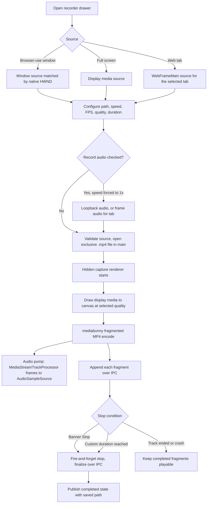

# Screen recorder flow

Output is fragmented MP4 (H.264/AVC, WebM VP9 fallback) muxed live with the
bundled mediabunny encoder. Completed fragments are appended to the file as
they are produced, so the recording stays playable even if the app quits or
the PC powers off before Stop is pressed. No system ffmpeg is required.

Sources: the Browser-use window (works minimized), full screen, or a single
web tab (Electron WebFrameMain capture — records the exact tab even when it
is not the visible one). An "Record audio" checkbox (OFF by default) adds a
128 kbps AAC (MP4) / Opus (WebM) track: system loopback audio for window and
screen sources, the tab's own audio (still audible while recorded) for web
tab. Audio is only offered at 1x speed, because the speed feature compresses
video timestamps while audio runs in real time.

```text
+----------------------------+
| Open recorder drawer       |
+------------+---------------+
             v
+----------------------------+
| Source: Browser-use window |
| (works minimized), full    |
| screen, or web tab         |
| (dropdown selects the tab) |
+------------+---------------+
             v
+----------------------------+
| Audio checkbox (off)?      |
| on  -> speed forced to 1x  |
+------------+---------------+
             v
+----------------------------+
| Save path (.mp4), speed    |
| 1x-10x, FPS, quality,      |
| auto or custom duration    |
+------------+---------------+
             v
+----------------------------+
| Start -> exclusive .mp4    |
| file opened in main; name  |
| auto-suffixes (2),(3),...  |
| if the path already exists |
+------------+---------------+
             v
+----------------------------+
| Hidden capture renderer    |
| display media -> canvas    |
| scaled to quality          |
| (window/screen source or   |
| WebFrameMain tab source)   |
+------------+---------------+
             v
+----------------------------+
| mediabunny Output          |
| Mp4OutputFormat            |
| fastStart:'fragmented'     |
| CanvasSource -> encoder    |
| (+AudioSampleSource 128k   |
|  fed by MediaStreamTrack   |
|  Processor at 1x; no       |
|  AudioContext, which would |
|  be autoplay-suspended in  |
|  the gestureless window)   |
+------------+---------------+
             v
+----------------------------+
| Each fragment appended via |
| computer-record-chunk IPC  |
| (file valid while writing) |
+------------+---------------+
             v
+----------------------------+
| Thin top banner: time +    |
| Stop (banner excluded from |
| capture via window mode or |
| excluded overlay surface)  |
+------------+---------------+
             v
+----------------------------+
| Stop -> finalize() closes  |
| file, publish completed    |
| state with saved path      |
+----------------------------+
```



Reliability contract: the capture renderer never throws across
`executeJavaScript` (Electron strips page-exception messages, which surfaced
as "[object Object]"); start failures return `{started: false, error}` and
also report over the finished IPC. Stop is fire-and-forget: the renderer
finalizes in the background and reports back over the finished IPC, because
`finish()` tears down the capture window and a still-pending
`executeJavaScript` promise would never settle. The main process validates
the capture source before starting so an unusable window or display fails
with a clear error, and output filenames auto-suffix "(2)", "(3)", ... when
the requested path already exists.

Crash safety: because `fastStart: 'fragmented'` writes `moof`/`mdat` pairs
continuously, every finished fragment is already on disk. A power loss leaves
a file playable up to the last completed fragment; only the in-flight
fragment is lost. The muxer writes strictly sequentially, so the main process
only ever appends incoming chunks to the file handle.
