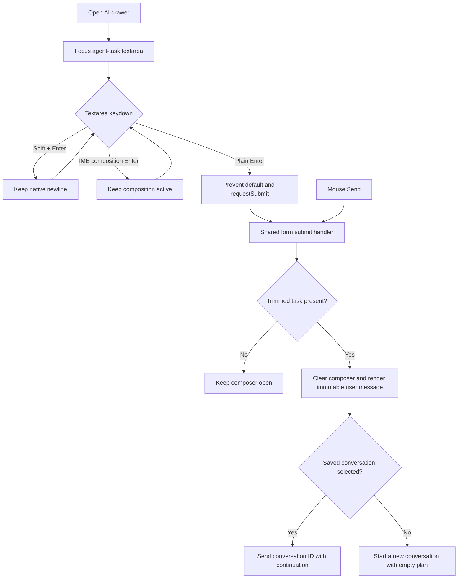
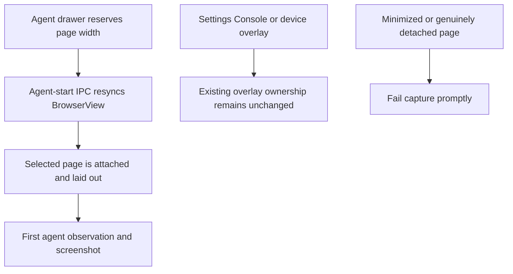
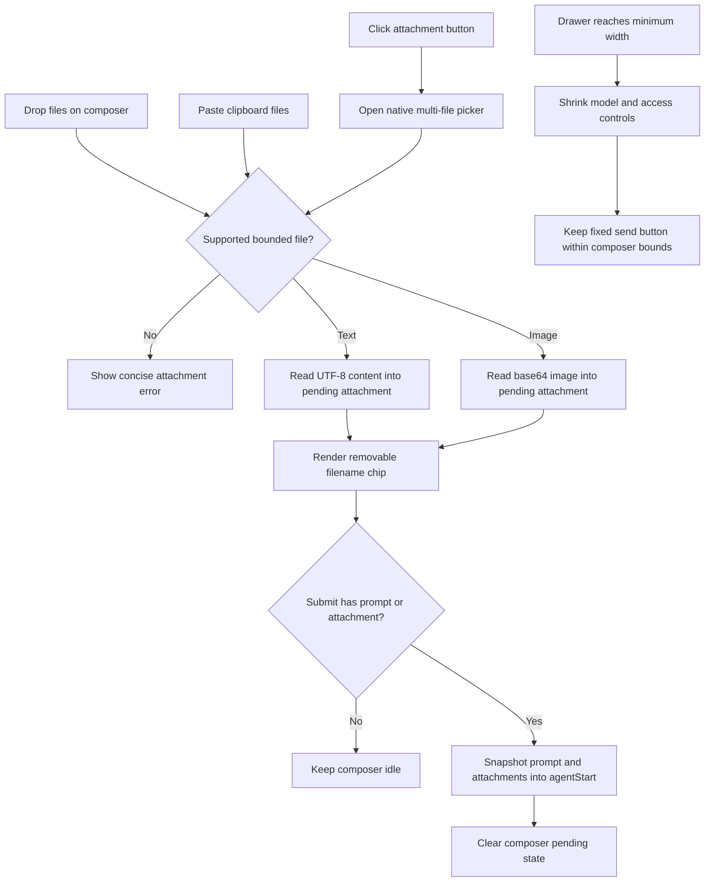
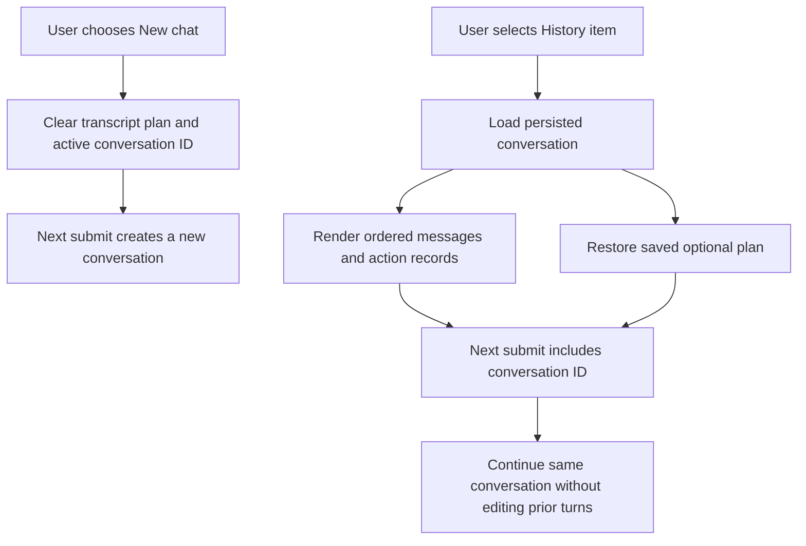
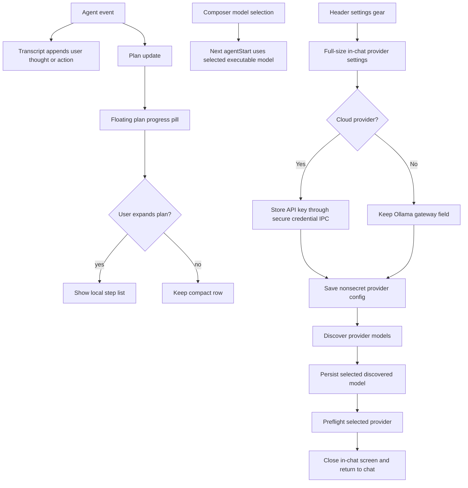
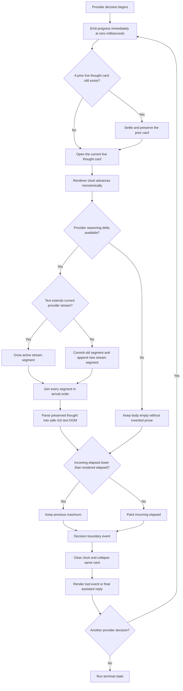
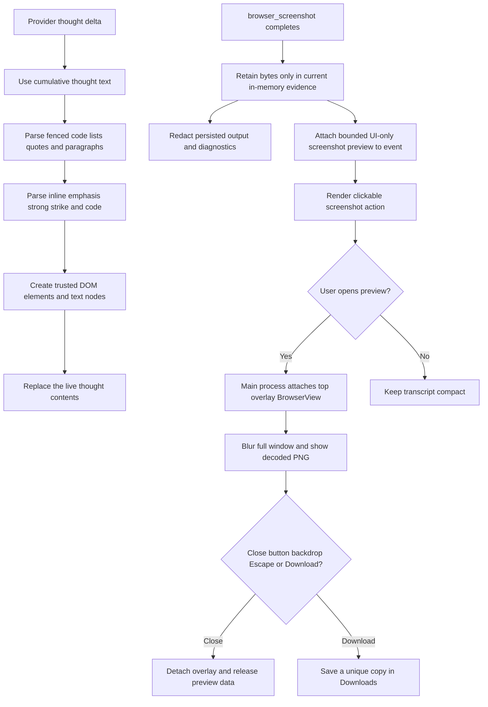
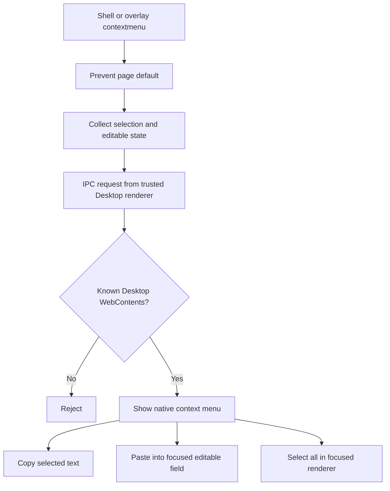
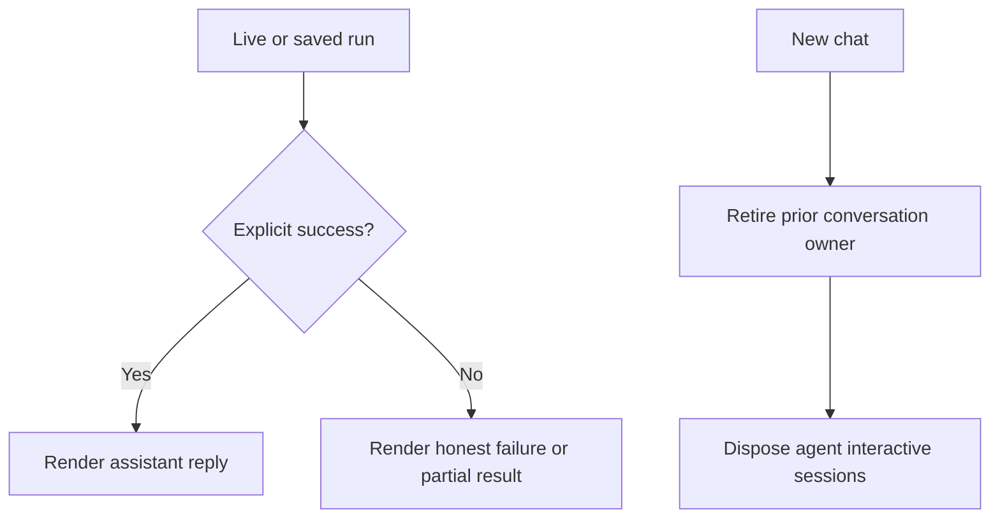
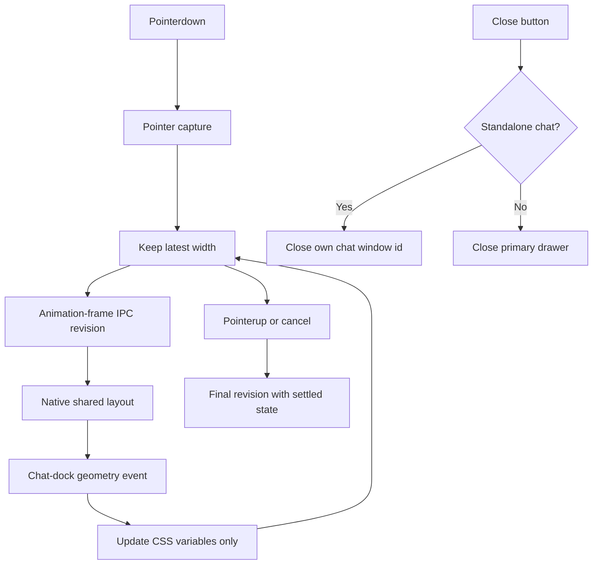

# Desktop renderer interaction flow

`desktop/renderer/app.js` owns browser chrome interactions and the in-window AI
composer. The composer treats a physical Enter as an explicit send action while
keeping multiline writing available without a separate editor mode.

## AI composer flow

The compact composer owns pending file attachments as local UI state. Matching
the connected Lorde AI composer, the paperclip, file drop, or pasted clipboard
file accepts images as provider-native vision input and every non-image as text
context. Accepted files become
removable chips, and submit snapshots those files into the same `agentStart`
request as the prompt. Model rows show the complete model identifier only;
selection is conveyed by the active row state instead of repeated provider
status copy. At the minimum drawer width, attachment/model/permission controls
may shrink, but the fixed send button must remain inside the composer bounds.
The drawer itself uses the same 320px minimum as the main-process BrowserView
reservation. Its resize separator is drawn inside the left edge so drawer
overflow clipping cannot hide the grip.

```text
+------------------------+
| User opens AI drawer   |
+-----------+------------+
            |
            v
+------------------------+
| Focus #agent-task      |
+-----------+------------+
            |
            v
+------------------------+
| keydown in textarea    |
+-----+------------+-----+
+     |            |
+     | Shift+Enter| Enter while composing
+     v            v
++----------------+  +-----------------------+
+| Native newline  |  | Keep IME composition  |
+| No submit       |  | No submit             |
++----------------+  +-----------------------+
+     |
+     +-----------------------------------+
+                                         |
+Plain Enter                              v
+     |                    +-------------------------+
+     v                    | Form submit (mouse or   |
++---------------------+   | keyboard)               |
+| preventDefault()    |   +-----------+-------------+
+| requestSubmit()     |               |
++---------------------+               v
+                           +-------------------------+
+                           | Trim, reject blank,     |
+                           | render, then agentStart |
+                           +-------------------------+
+```



## Computer-mode selectors

The chat composer adds one Browser only / AGI scope selector while retaining the
existing Full access / Ask permission selector and Stop. Its save completes
before agentStart. MCP Settings has its separate scope selector in the actual
native overlay, mirrored in the underlying shell. Both use existing settings
IPC and receive authoritative saved mode values; no new approval UI is added.
The model control shrinks before the fixed Send/Stop button at 320px width.
See `../computer/computerTools_flow_chat.md` for the shared ASCII/Mermaid map.

## Agent capture preparation

```text
+--------------------------+
| Agent drawer is open     |
| Page width is reserved   |
+------------+-------------+
             |
             v
+--------------------------+
| Agent-start IPC          |
| sync BrowserView layout  |
+------------+-------------+
             |
             v
+--------------------------+
| Selected page attached   |
| and capture-ready        |
+------------+-------------+
             |
             v
+--------------------------+
| First observe/screenshot |
+--------------------------+

Settings, Console, and device-menu overlays keep their own native overlay
ownership. A minimized window or genuinely detached page remains non-paintable.
```



## Invariants

- A `browser_done` summary is painted as an assistant reply only when the
  executor accepted that terminal action. Rejected completion attempts render
  as non-terminal recovery cards while the run continues.

1. Plain Enter causes at most one submission and never inserts its own newline.
2. Shift+Enter only changes textarea content; it does not start an agent run.
3. IME composition confirmation is not interpreted as a request to submit.
4. Keyboard and mouse submission share the same form submit handler.
5. During a provider turn, the transcript owns one live `<details>` thinking
   card. Native streamed reasoning updates its body without creating new
   entries; the card contains no fabricated fallback sentence before the first
   real token. Final decision settlement collapses that same card to
   `Thought for <duration>`. A terminal `browser_done` summary is the one final
   assistant reply, so protocol JSON cannot create a conflicting reply.
6. Structured JSON action chunks are protocol data, never user-visible thought text.
7. The dark transcript shell keeps the active plan in a floating pill above the
   composer: it shows progress while collapsed and expands locally without
   changing the agent run, covering the composer, or sending a message. Plan-tool
   bookkeeping updates this surface in place and never adds a transcript action.
8. The composer model picker always reflects the selected executable model;
   visual model selection must not substitute an unavailable provider.
9. The header contains only the conversation title and active-tab title; it
   never exposes a URL, suggestion chips, or a duplicate provider/model label.
10. The chat settings icon opens a full-size settings screen inside the AI
   chat drawer. It never opens or repurposes the Browser-use settings overlay.
   Closing that screen returns to the active chat.
11. Provider settings are a single screen (not a tab set) with the Studio
   catalog (Ollama, OpenAI, Anthropic, Gemini, DeepSeek, xAI, Perplexity,
   OpenRouter, xKiro, Groq, and Browser Use Cloud) and saved connections.
   Models are selected from the composer’s exact Studio-sized searchable drawer
   (`min(280px, viewport)` by `min(360px, viewport)`) rather than from a
   separate settings page. The search input is retained in place while the
   options list rerenders, so every typed character and its caret survive a
   model-list refresh.
12. A saved connection stores only non-secret configuration. Its API key is
   stored by connection ID in secure credential storage. Ollama and Browser
   Use Cloud keep their native transports; the other listed providers use the
   OpenAI-compatible or Anthropic runtime adapter.
13. Every user turn, including a greeting, is sent through the selected model;
    the renderer contains no task-specific or benchmark-specific reply path.
14. Provider onboarding has no manual model-ID input. Saving a connection
    stores its non-secret configuration, discovers that provider's available
    models, persists the selected model on the connection, and then runs its
    explicit preflight. If discovery returns no usable model, the UI reports
    that provider result without inventing a generic fallback model.
15. Empty assistant-message events are ignored. A final `browser_done` summary
    or terminal run state paints exactly one full-white natural-size assistant
     reply after its thought card settles.
16. The title is metadata only. History paints ordered persisted messages and
    never substitutes the title for the first user prompt.
17. A new chat clears the plan. Selecting a saved chat restores that chat's
    plan and sends its conversation ID on the next follow-up.
18. The paperclip is an operable attachment button. Pending supported text and
    image files are visible and removable before submit, then travel with that
    exact user turn; creating a new chat also clears pending files.
19. Model options do not repeat discovery/provider labels. The model identifier
    owns the row width, while selection is represented by the active row state.
20. At the minimum drawer width, the send button remains wholly inside the
    composer. Auxiliary controls shrink or clip before the submit action moves.
21. The drawer width never has a renderer-only minimum. Its 320px clamp is the
    same value reserved by the native BrowserView, and the resize separator's
    visible line remains inside the clipped drawer boundary.
22. Settings keeps pairing secrets renderer-local. Creating an offer enables a
    dedicated Copy pairing code action; an HTTP-created offer clears any stale
    renderer-held code when its expiry identity changes. The Claude Code action
    copies a `headersHelper` installer so later Claude sessions obtain their
    own fresh offer instead of reusing the displayed code.

## Attachment and compact-width flow

```text
+------------------------+
| Click paperclip button |
+-----------+------------+
            v
+------------------------+
| Native multi-file input|
+-----------+------------+
            v
+------------------------+
| Read bounded text/image|
| and render remove chips|
+-----------+------------+
            v
+------------------------+
| Submit prompt or files |
+-----------+------------+
            v
+------------------------+
| Snapshot attachments in|
| agentStart request      |
+------------------------+

Minimum drawer width:
[attach] [model shrinks] [access shrinks] [send stays visible]
```



## Conversation selection flow

```text
+---------------------+
| New chat or history |
+------+----------+---+
       |          |
      new       history
       |          |
       v          v
+------------+ +-----------------------+
| Clear view | | Load title, messages, |
| + plan     | | tools, and saved plan |
+------+-----+ +-----------+-----------+
       |                   |
       v                   v
 next submit creates   next submit resumes
 new conversation      same conversation ID
```



## Shell presentation state

```text
+----------------------------+
| Header: chat + active tab   |
+-------------+--------------+
              |
              v
+----------------------------+
| Scrollable transcript      |
| user, thoughts, actions    |
+-------------+--------------+
              |
              v
+----------------------------+
| Floating plan collapsed?   |
+-----+------------------+---+
      | yes              | no
      v                  v
  progress pill     task list overlay
      |                  |
      +--------+---------+
               v
+----------------------------+
| Composer: model + send     |
+----------------------------+

Settings gear -> full-size in-chat provider screen
             -> save connection and secure key
             -> provider model discovery -> persist selected model
             -> explicit preflight -> return to chat
```



## Streaming thought lifecycle

```text
+------------------------------+
| Provider decision starts     |
| event arrives at elapsed 0ms |
+---------------+--------------+
                v
+------------------------------+
| Prior live card still open?  |
+---+----------------------+---+
    | yes                  | no
    v                      |
+--------------------+     |
| Settle prior card  |     |
| without deleting it|     |
+---------+----------+     |
          +----------------+
                |
                v
+------------------------------+
| Open the live Thinking card  |
| and store monotonic time     |
+---------------+--------------+
                v
+------------------------------+
| Renderer clock and provider  |
| stream state update in place |
+---------------+--------------+
                v
+------------------------------+
| Incoming text extends the    |
| current provider stream?     |
+---+----------------------+---+
    | yes                  | no
    v                      v
+---------------+  +--------------------+
| Grow current  |  | Commit prior stream|
| stream segment|  | append new segment |
+-------+-------+  +---------+----------+
        +--------------------+
                |
                v
        +-------+--------+
        | Later event has |
        | lower elapsed?  |
        +---+---------+---+
            |         |
           yes       no
            |         |
            v         v
      keep maximum   accept time
            +---------+
                |
                v
+------------------------------+
| Decision boundary event      |
| clears timer + collapses card|
+---------------+--------------+
                v
+------------------------------+
| Tool event or final reply    |
+------------------------------+
```



Only the current live thought card accepts streaming deltas. Every tool or final
assistant event settles that card before it renders a separate transcript item,
so replies cannot become thought content. A new zero-time decision also settles
any still-open card first; recovery loops therefore preserve the prior decision
even when no tool event occurred. Replacing transcript contents (new chat or
history) clears the live timer and DOM reference before any later event arrives.
Provider retries and schema-repair streams inside one decision are separate
segments: a reset commits the prior segment and appends the new one, never
replacing already-visible thought text.

## Thought formatting and screenshot preview

```text
+---------------------------+       +---------------------------+
| Cumulative thought text   |       | browser_screenshot result |
+-------------+-------------+       +-------------+-------------+
              v                                   v
+---------------------------+       +---------------------------+
| Parse blocks and inline   |       | Keep diagnostics redacted |
| markers into DOM nodes    |       | send UI-only image preview|
+-------------+-------------+       +-------------+-------------+
              v                                   v
+---------------------------+       +---------------------------+
| Replace live thought body |       | Render screenshot action  |
| no raw HTML assignment    |       | with Open preview button  |
+---------------------------+       +-------------+-------------+
                                                  v
                                    +---------------------------+
                                    | Click requests native-safe|
                                    | top overlay preview       |
                                    +---------------------------+
```



Saved report actions follow the same route: the filename is rendered as a
clickable chat link, the main process validates that it belongs to the managed
report directory, and the top overlay renders TXT as preformatted text or HTML
inside a scriptless sandbox. The page BrowserView and shell are both beneath
the blurred overlay, so neither report nor screenshot previews can be covered
by the active tab.

The rich-text path never assigns model text to `innerHTML`; formatting is
created with explicit elements and text nodes. Screenshot bytes remain absent
from diagnostic inspection, conversation history, and serialized run state.
They are exposed only on the live renderer event that creates the preview.
Thought formatting preserves the established compact treatment: 13px italic
grey text, with headings and emphasis using the same grey and medium weight.

## Shell context-menu flow

```text
+-------------------------+
| Right-click shell or    |
| Settings overlay        |
+-----------+-------------+
            |
            v
+-------------------------+
| Determine selection and |
| editable target         |
+-----------+-------------+
            |
            v
+-------------------------+
| Trusted renderer asks   |
| main for native menu    |
+-----------+-------------+
            |
            v
+--------------------------+
| Copy | Paste | Select all|
+--------------------------+
```



Right-clicking a trusted shell or Settings surface always opens this native
menu. BrowserView page content has no shell IPC access, so its own page context
menu stays independent of Desktop controls.

## Outcome display and conversation retirement

```text
+--------------------------+
| Live or saved agent run  |
+------------+-------------+
             v
+--------------------------+
| Use explicit success     |
| verified and reason      |
+------+-------------------+
       |              |
   success           failure
       v              v
 Assistant reply   Error or partial

New chat -> retire prior conversation owner -> close agent PTYs.
```



## Multi-chat resize and close routing

```text
+--------------------------+
| Pointerdown on chat grip |
+------------+-------------+
             v
+--------------------------+
| Capture pointer and keep |
| only the latest width    |
+------------+-------------+
             v
+--------------------------+
| requestAnimationFrame    |
| sends one width revision |
+------------+-------------+
             v
+--------------------------+
| Main process lays out    |
| page and every chat     |
+------------+-------------+
             v
+--------------------------+
| Geometry event updates   |
| CSS offset without chat  |
| transcript rerender      |
+------------+-------------+
             v
+--------------------------+
| Pointerup sends final    |
| settled state            |
+--------------------------+

[data-close=agent] in Chat 2/3 -> closeChatWindow(own chatWindow id)
[data-close=agent] in Chat 1   -> requestDrawer(null)
```


