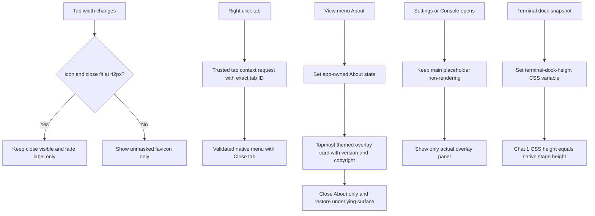

# Tab close, app About modal and dock geometry corrections

## Audit

- Tab close was hidden at width <95px, even though favicon and close need only 42px.
- Tab context clicks fell through to the generic shell Copy/Paste menu, with no tab ID.
- About used the OS panel rather than the existing app-owned native overlay.
- Main Settings and Console placeholders became visible when their real overlay opened.
  Their old top offset left a small extra surface above the actual Settings popup.
- Main chat CSS reserved `--terminal-dock-height` but no renderer updated that variable.
  Native page and extra chats resized, while Chat 1 overlapped the docked terminal.

```text
+-----------------------+      +---------------------------+
| Tab width decreases   | ---> | Fade label first          |
+-----------------------+      | Keep icon and X to 42px   |
                               | Icon only below 42px      |
                               +---------------------------+

+-----------------------+      +---------------------------+
| Tab right click       | ---> | Pass exact clicked tab ID |
+-----------------------+      | Main validates owner + ID |
                               | Close tab action remains  |
                               +---------------------------+

+-----------------------+      +---------------------------+
| View > About          | ---> | App overlay themed card   |
+-----------------------+      | Live name/version/year    |
                               | Close returns prior UI    |
                               +---------------------------+

+-----------------------+      +---------------------------+
| Terminal dock changes | ---> | Main computes dock height |
+-----------------------+      | Renderer sets same CSS var|
                               | Chat 1 ends at dock top   |
                               +---------------------------+
```


