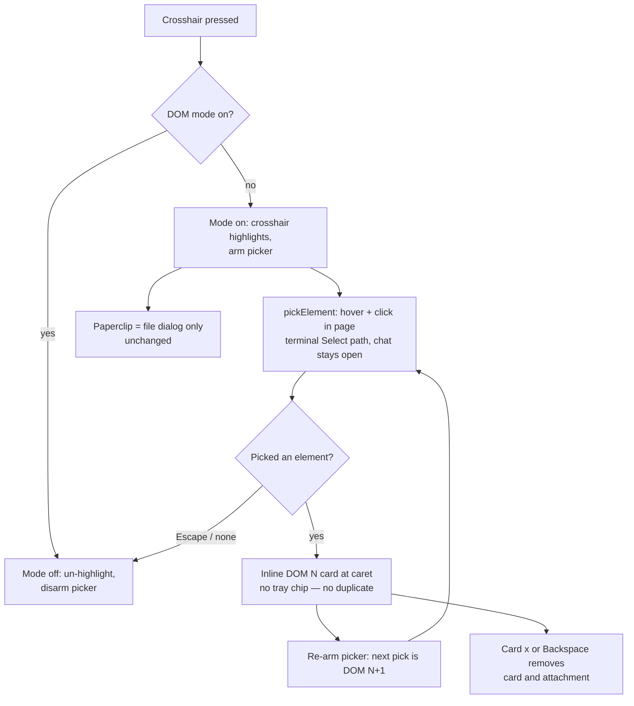

# DOM-attachment mode (terminal Select path) — Flowchart

## Purpose
Two separate, single-purpose composer controls:

- **Paperclip** — the ordinary file dialog, exactly as it always was.
- **DOM-select icon** (crosshair, to the paperclip's RIGHT) — toggles DOM
  selection mode: the icon highlights while active; clicking it again or
  pressing Escape exits (disarming the in-page picker).

Inside DOM-selection mode, element selection REUSES the proven in-page picker
behind the terminal's Select action (`pickElement` IPC +
`src/browser/elementPicker.cjs`): hover outline, selecting click swallowed in
capture phase, touch support, Escape to cancel. The picker re-arms after every
pick, so selections chain as **DOM 1**, **DOM 2**, **DOM 3**…

Each picked element becomes a real **inline card in the composer** — a
non-editable `DOM N ✕` pill sitting in the sentence where the caret was
(like an @-mention), NOT literal text, and NOT a tray chip: the card is the
only UI for a DOM attachment (no duplicate). The user types around the cards:
`move [DOM 1] above [DOM 2] and make sure [DOM 3] is rounded`. The card's
small ✕ (or Backspace) removes the card AND its attachment; on send, each
card serializes to its `DOM N` label so the model reads the sentence
naturally, with the named attachments delivered alongside.

The composer is a contenteditable rich editor behind a `value` shim, so every
existing reader/writer (submit, queue, restore, run buttons) keeps working
unchanged. The agent drawer stays open throughout: `stageBounds()` reserves a
real right-hand strip for agent chat, so the page is live beside it.
`pickElement` refuses only drawers that COVER the page (settings, console).

## Participants
- `desktop/renderer/index.html` — paperclip (`#agent-attach`, file dialog) + `#agent-dom-select` crosshair button.
- `desktop/renderer/chat-reference.css` — `.agent-dom-select-button` with `.is-active` highlight; inline `.dom-attach-card` styles.
- `desktop/renderer/app.js` — mode toggle, `runDomPickLoop`, `attachDomElement` (inline card only, `inline: true` skips the tray), `insertDomCardAtCaret`, `removeDomAttachment`, `value` shim, `composerPlainText`.
- `desktop/main.cjs` `pickElement()` / `cancelPickElement()` — unchanged poll loop (60s bound).
- `src/browser/elementPicker.cjs` — `describe()` returns bounded `outerHTML` (40k cap).
- Existing attachment pipeline: 120k/240k text budgets, model context.

## Process flow (ASCII)

```
  +------------------------------+     +---------------------------+
  | paperclip pressed            |     | crosshair pressed         |
  | -> agentFileInput.click()    |     | -> toggle DOM mode        |
  |    (unchanged file dialog)   |     +-------------+-------------+
  +------------------------------+                   v
                                       +---------------------------+
                                       | mode ON: crosshair        |
                                       | highlights, picker arms   |
                                       +-------------+-------------+
                                                     v
                                       +---------------------------+
                                       | pickElement (terminal     |
                                       | Select path, 60s bound)   |
                                       +-------------+-------------+
                                                     v
                                             +---------------+
                                             | picked?       |
                                             +--+---------+--+
                                          yes  |         |  Escape/none/timeout
                                                v         v
                                       +-------------+  exit: crosshair
                                       | inline card |  un-highlights,
                                       | "DOM N ✕"   |  picker disarmed
                                       | at caret    |  (timeout -> note)
                                       +-------------+
                                                |  re-arm: next pick DOM N+1
                                                v
                                       +---------------------------+
                                       | card ✕ / Backspace removes|
                                       | card + attachment; send   |
                                       | serializes cards to names |
                                       +---------------------------+
```

## Mermaid flow



## Guarantees
- Paperclip behavior is byte-identical to the original file dialog.
- One selection path, already proven in the terminal; the selecting click can never activate a destructive page control.
- A DOM attachment has exactly ONE visual representation: the inline card. Removing it removes the attachment everywhere; nothing duplicates.
- The agent drawer stays open (page live beside chat); only settings/console overlays require closing before picking.
- Exiting the mode ALWAYS disarms the in-page picker; the generation counter retires any pending pick loop.
- Attachment text is bounded (40k from the picker, 120k per-attachment budget) and labelled with the element's CSS selector and page URL.
