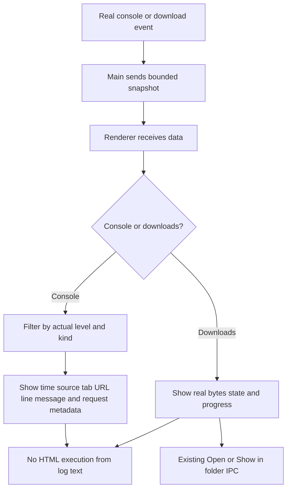

# Shared console and download rendering

```text
+--------------------+     +------------------------+
| Main process data  | --> | Clone-safe IPC events  |
+--------------------+     +------------+-----------+
                                       v
                          +------------------------+
                          | Shared renderer helper |
                          | Fields use textContent |
                          +---------+--------------+
                                    v
                          +------------------------+
                          | Console filters or     |
                          | Downloads open/reveal  |
                          +------------------------+
```


