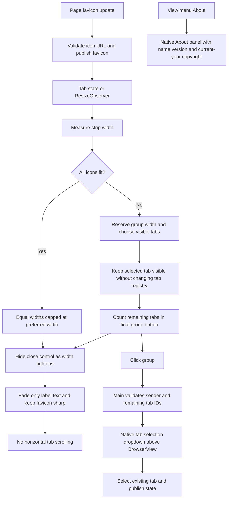

# Responsive tab strip

## Geometry

The title/menu row remains separate from the full-width tabs row and the browser
navigation toolbar. Each tab has an unmasked 16px site icon. Inactive tabs are
transparent with a thin trailing divider. Only the active tab has a light grey
rectangular surface. Labels fade through a gradient mask, never an ellipsis.

Let W be available strip width, N tab count, M minimum icon-only width, G group
width, and P preferred tab width. If N*M <= W, all tabs remain visible and their
width is min(P,W/N). Otherwise, reserve G and render floor((W-G)/M) tabs plus
one final counted group. Keep the selected tab in the visible set and keep all
remaining tab IDs intact in the native dropdown.

```text
+-----------------------------+
| Tab state or strip resized  |
+-------------+---------------+
              v
+-----------------------------+
| Fit labels, then fade text  |
| Keep favicon unmasked       |
+-------------+---------------+
              v
+-----------------------------+
| All tabs fit at icon width? |
+------+----------------------+
  yes  |                 no   |
       v                      v
+----------------+  +-------------------------+
| Equal shrinking|  | Reserve counted group   |
| No scrollbar   |  | Keep selected visible   |
+----------------+  +------------+------------+
                                 v
                      +------------------------+
                      | Last group opens native|
                      | menu of remaining tabs |
                      +------------------------+
```


