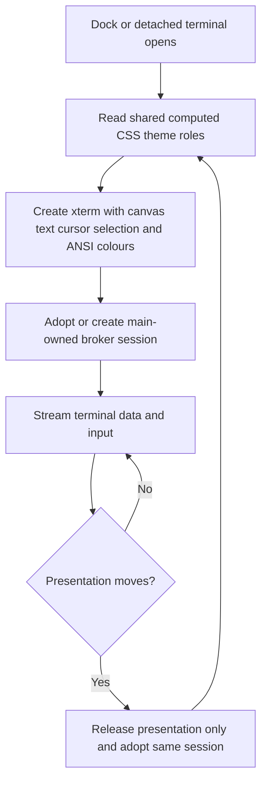

# Terminal presentation and theme flow

The shell belongs to the existing terminal broker. Theme changes affect only
xterm presentation, never session creation, attachment, input, or shutdown.

```text
+-----------------------+
| Dock or detached view |
+-----------+-----------+
            v
+-----------------------+
| Load chrome-theme.css |
| Read computed tokens  |
+-----------+-----------+
            v
+-----------------------+
| Create themed xterm   |
| Preserve ANSI colours |
+-----------+-----------+
            v
+-----------------------+
| Adopt broker session  |
| Stream output/input   |
+-----------------------+
```


