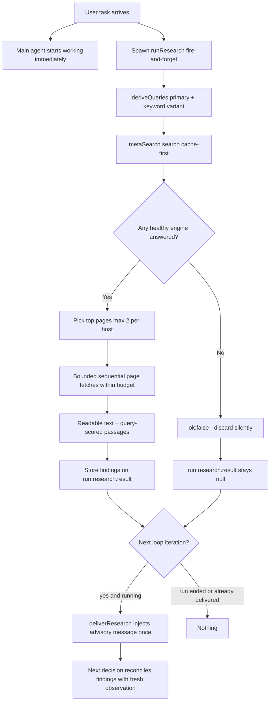
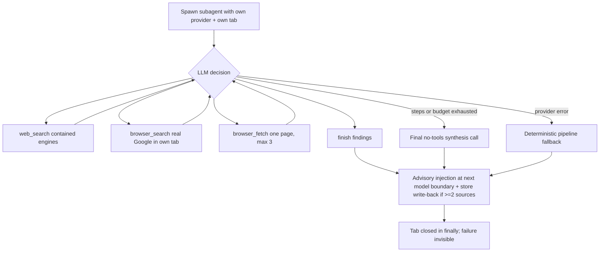

# Research pipeline (contained meta-search + background research worker)

## Scope and authority

The research pipeline gives the chat agent a background research capability that
mirrors how a human starts an unfamiliar task: read tutorials and docs while
already beginning the work. It is **fully contained**: no Docker, no external
service, no Python runtime, no new processes. searXNG is a Python/Flask
application, so this module implements **searXNG's contract** — fan a query out
to multiple engines, normalize, deduplicate, rank-fuse, and return JSON — as a
pure Node module inside the Electron main process.

Non-negotiable invariants:

1. **The run never waits.** The working agent starts acting immediately. Findings
   arrive as advisory context at a later model boundary, at most once per run.
2. **Failure is invisible.** Any research error, timeout, abort, or empty result
   discards silently. No event, no transcript card, no run-state change. The run
   and the user must never notice research existed.
3. **Zero critical-path latency.** Research work happens on the main process
   event loop in small async steps; it never blocks a decision, an action, or an
   observation. The injection is one bounded message append.
4. **Program-agnostic by construction.** No app names, no task-specific code.
   All knowledge about an unknown program flows in as data (findings text), and
   later out through the knowledge store — never through code.
5. **ToS-safe by design.** Human-scale volume (1-2 meta-search calls per task),
   per-engine token-bucket rate limits, cache-first, no CAPTCHA solving, no
   crawling. A blocked or challenged engine is health-marked with exponential
   backoff and skipped; the other engines cover. Degraded results are fine
   because findings are advisory.

```text
+---------------------------------------------------------------+
| Electron main process (Browser Use app)                       |
|                                                               |
| desktopChatAgent.start(task)                                  |
|   +--> normal run setup, Skill Brain, publish run.started     |
|   +--> run research (fire-and-forget, never awaited)          |
|              |                                                |
|              v                                                |
|   +---------------------------+                               |
|   | researchWorker.runResearch|   budget ~30s, max 5 pages    |
|   +------------+--------------+                               |
|                |                                              |
|    deriveQueries(task)  [primary + keyword variant]           |
|                |                                              |
|                v                                              |
|   +---------------------------+                               |
|   | metaSearch.search(query)  |  cache-first                  |
|   |  engine adapters x N      |  per-engine token bucket      |
|   |   duckduckgo, bing(rss),  |  health registry w/ backoff   |
|   |   brave, mojeek, yahoo,   |  normalize + dedupe           |
|   |   qwant, google           |  Reciprocal Rank Fusion       |
|   +------------+--------------+  cap top 8                    |
|                |                                              |
|    top pages (<=2 per host) -> bounded fetch (12s/1MB each,   |
|    sequential) -> readable text -> query-scored passages      |
|                |                                              |
|                v                                              |
|   findings (sources + passages, <= 8k chars)                  |
|   stored on run.research.result; NEVER awaited by the loop    |
+-------------------------------+-------------------------------+
                                |
        next loop iteration, model boundary:
        deliverResearch(run) injects once as a runtime-sourced
        advisory user-role message (Skill Brain precedent).
        Failure / empty / already-delivered / run ended -> nothing.
```



## Module: `metaSearch.cjs`

Algorithms:

- **Engine adapters.** Each adapter owns `{ name, buildUrl(query), parse(body), minIntervalMs, timeoutMs }`.
  - `duckduckgo`: `https://html.duckduckgo.com/html/?q=`; anchors `a.result__a`,
    snippets `result__snippet`; unwraps `/l/?uddg=<encoded>` redirects.
  - `bing`: `https://www.bing.com/search?q=&format=rss&count=15`; RSS `<item>`
    title/link/description — the most parser-stable and ToS-considerate surface.
  - `brave`, `mojeek`, `yahoo`, `qwant` (JSON API), `google`: best-effort HTML/JSON
    parsers with defensive regexes; a markup change degrades one engine, never
    the pipeline.
- **Rate limiting.** Per-engine token bucket: at least `minIntervalMs` between
  requests to the same engine (google 3000ms, bing 1500ms, others 800ms) plus a
  global concurrency cap of 4. Identical in-flight queries share one promise.
- **Health registry.** Consecutive failures raise an exponential cooldown
  (60s x 2^(failures-1), capped 30min). Success resets. A cooled-down engine is
  skipped without a network call and reported as `status: 'cooldown'`.
- **Deduplication.** Normalize URLs (lowercase host, drop `www.`, strip fragment
  and tracking params: utm_*, fbclid, gclid, msclkid, ref, ref_src, cmpid,
  mc_cid/mc_eid, igshid, _hsenc), exact-dup on normalized URL, near-dup on title
  token Jaccard >= 0.85 (keep the higher-ranked copy).
- **Fusion.** Reciprocal Rank Fusion: `score = sum(1 / (60 + rankInEngine))`;
  ties break toward results appearing in more engines. Cap `limit` (default 8).
- **Cache.** Normalized query -> result, TTL 300s, max 200 entries (oldest
  evicted). A cache hit performs zero network calls.
- **Abort.** A caller signal short-circuits to `{ ok: false, aborted: true }`.
  All engines run under their own per-request AbortControllers.

Output contract (the JSON the worker receives — engines are never exposed to
the agent, only to this module):

```json
{ "ok": true, "query": "...", "tookMs": 812,
  "results": [{ "title": "...", "url": "...", "snippet": "...", "engines": ["bing","duckduckgo"], "score": 0.0312 }],
  "engines": [{ "name": "bing", "status": "ok", "count": 10, "ms": 340 }],
  "degraded": false }
```

## Module: `researchWorker.cjs`

- `deriveQueries(task)`: primary = the task itself (bounded 180 chars); keyword
  variant = lowercase, punctuation and stopword-stripped, first 10 tokens. The
  variant runs only when the primary returned fewer than 3 results.
- Page selection: top `maxPages` (default 5) results, at most 2 per host.
- `createFetchPage`: bounded fetch — 12s timeout, 1MB cap (Content-Length
  checked, decoded body sliced), text/html + text/plain + text/xml +
  application/json only. Injected in tests; never follows non-HTTP schemes.
- `extractReadableText(html)`: drops `<script|style|noscript|svg|head>`, strips
  tags, whitespace-normalizes.
- `extractPassages(text, queryTokens)`: splits into paragraph/sentence chunks,
  scores by distinct query-token overlap with a small early-position bonus, keeps
  the top 8 chunks of 80-400 chars.
- `findings`: header (queries, tookMs), source list `[n] title — url (engines)`,
  passage list `[n] "..." (from source n)`. Hard cap 8000 chars.
- Budget: `budgetMs` (default 30s) checked between every phase; an in-flight
  page fetch is raced against the remaining deadline. Aborted signal or exhausted
  budget returns whatever was already gathered (partial is useful; silence is not
  failure).
- The worker **never throws**. Every path returns a result object; catch-all
  maps to `{ ok: false, error }`.

## Chat-agent wiring (`desktopChatAgent.cjs`)

- **Model-decided spawn (the `research_task` tool)**: the run NEVER spawns
  research automatically — every message used to, which burned provider cost
  on trivial chats and sent the subagent hammering Google into recaptcha.
  The strong model calls `research_task {objective}` when the task hinges on
  unfamiliar software specifics; `spawnResearch(run, objective)` then spawns
  the runner (default `researchRunner` option injected in tests, or the
  deterministic fallback unless `BROWSER_USE_RESEARCH=off`). State lives on
  `run.research = { promise, result, delivered, pending }`; a second call
  while pending is a no-op; the promise is never awaited by the run loop and
  its rejection is swallowed by design.
- **Browser engine**: the subagent's tab search uses **DuckDuckGo
  (`html.duckduckgo.com`)** via `controller.search(..., engine:'duckduckgo')`
  — rapid automated Google queries trip the recaptcha wall a human-paced
  search never sees. Result redirects (`/l/?uddg=…`) are decoded by
  `decodeDuckDuckGoHref`; ad redirects (`y.js`) are filtered.
- Loop top, directly after `deliverSteering(run)`: `deliverResearch(run)` —
  if the worker settled with usable findings and the run is still running,
  append ONE runtime-sourced advisory user-role message (the Skill Brain
  precedent: runtime context, never a user-typed turn) and publish
  `user.message.delivered`. Delivered at most once per run.
- `cancel()`: the existing `abortController.abort()` propagates through the
  worker signal; the swallowed rejection path discards the result.
- `serializeRun()`: `research`, `researchHost` and `researchDefaults` join the
  destructured runtime-only fields — promises and the agent instance must
  never reach Electron `structuredClone`, persisted conversations, or events.

## The pre-added Program Control skill (`programControlResearch.cjs`)

When a run takes control of a native program (AGI mode, desktop observation),
the agent auto-starts ONE non-blocking research pass the first time it sees a
program the brain knows nothing about:

```text
computer observation with a foreground program
        |
        v
programFromObservation(): title -> program name
  (noise/doc-only/implausible titles are honestly skipped)
        |
        v
brainKnowsProgram(store, program)?  --yes--> publish 'program.research.cached'
        | no                                  (recall serves the run instead)
        v
spawnResearch(objective, {kind:'recipe', key:program})
  objective steers the subagent at OFFICIAL docs, the user manual, tutorials
  and forum answers: menu paths, hotkeys, dialog names, URI schemes
        |
        v
findings -> advisory context this run + knowledgeStore recipe keyed by program
```

Learnt once — every later run with the same program recalls from the brain
cache (`program.research.cached`) instead of researching again.

## What this module deliberately does NOT do

- No crawling or bulk fetching: at most 5 pages per task, sequential, bounded.
- No CAPTCHA/proxy/IP-rotation machinery: an engine that challenges is marked
  unhealthy and skipped; the pipeline degrades instead of evading.
- No LLM calls: summarization is deterministic extractive scoring, so research
  adds no provider cost and cannot blow the decision budget.
- No direct engine access from the agent: `metaSearch` is the single egress.
- No mutation of the working tab: research fetches are Node-side, independent of
  the browser session, and can never trip the agent's own browsing state.

## Verification

`tests/desktop-research-pipeline.test.mjs` — offline fixtures only:

1. metaSearch merges engines, dedupes tracking-variant URLs, RRF ranks a result
   ranked first by two engines above a single-engine first rank.
2. Cache hit performs zero fetches; TTL expiry refetches.
3. One failing engine degrades (`degraded: true`) without losing other results.
4. Two consecutive engine failures cool the engine down (skipped, no fetch) and
   a success resets health.
5. Caller abort returns `{ ok: false, aborted: true }` without throwing.
6. Worker produces sources + passages from fixture pages; total-failure fetch
   still yields an ok result with a bare source list.
7. Hung page fetch is raced against the budget; the worker finalizes partial.
8. Pre-aborted signal returns `{ ok: false, aborted: true }` with no fetches.
9. Chat-agent integration: findings settle during decision 1 -> the injected
   runtime message is visible to decision 2 and marked `source: 'runtime'`;
   a rejecting runner leaves the run untouched; the serialized run carries no
   `research` key and survives `structuredClone`.

## The real research subagent (2026-09-21)

The deterministic pipeline forwards what engines return — useful when the
engines are useful, useless when they serve junk. The contained pipeline is now
the FALLBACK; the default in production is `researchAgent.cjs`: a bounded LLM
tool loop that DECIDES what to search, which results to read, and what to keep.
It is not a programmatic query that forwards everything it receives — its only
output is one synthesized findings brief with source URLs.

```text
run starts ──> spawn runResearchAgent (fire-and-forget, own provider instance)
                    |
      +-------------+-----------------------------+
      |  LLM decisions (<= 8 steps, 90s budget)   |
      |  tools: web_search  (contained engines)   |
      |         browser_search (REAL Google in a  |
      |           DEDICATED background tab — the  |
      |           user's tab is never touched)    |
      |         browser_fetch (<= 3 page reads)   |
      |         finish {findings}                 |
      +------------------+------------------------+
                         |
        steps exhausted without finish -> ONE final
        no-tools call: "write the brief from evidence"
                         |
                         v
        findings brief + tracked source URLs
                         |
   provider fails / no provider -> deterministic
   pipeline (metaSearch + extractive) as fallback
```



Wiring: `main.cjs` passes `researchRunner: defaultResearchAgent` (production)
plus the shared MetaSearch; un-wired builds and provider-scripted tests get
`defaultDeterministicResearch` (hermetic — no provider calls). The agent-side
context builder hands the subagent its own provider instance (the connection
the run selected) and a browser surface (createTab/search/fetchPage/closeTab)
scoped to a dedicated tab that is closed in a `finally`.
