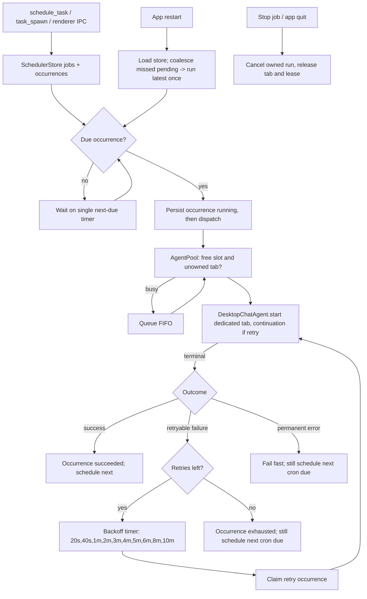

# Scheduler, task queue and parallel agent pool

## Scope

In-app scheduler (jobs fire while Browser-use runs; the ledger persists across restarts and missed ticks coalesce on launch), a serialized-run-capable parallel agent pool (true multi-agent with a shared controller and an exclusive desktop lease for native input), and the agent-facing `schedule_task` / `task_spawn` tools. `desktopChatAgent.cjs` is unchanged: parallelism comes from multiple agent instances, one per active run, each pinned to its own background tab.

```text
+---------------------+     +---------------------------+
| chat: schedule_task |     | renderer: Schedules list  |
| task_spawn          |     | IPC schedule-* channels   |
+---------+-----------+     +------------+--------------+
          |        create/pause/remove    list/update
          v                                  |
   +----------------------------------------------+
   | SchedulerStore (schedules.json, atomic write) |
   |  jobs[]              occurrences[]            |
   +----------------------+-----------------------+
                          v
   +----------------------------------------------+
   | Scheduler engine: ONE next-due timer          |
   |  due -> claim occurrence (persist BEFORE run) |
   |  load -> coalesce missed (latest runs once)   |
   +----------------------+-----------------------+
                          v
   +----------------------------------------------+
   | AgentPool (cap 3): allocate background tab    |
   |  exclusive desktop lease for mutating input   |
   |  per-instance DesktopChatAgent + emit         |
   +----------------------+-----------------------+
           failed run    |           succeeded
          retryable      v
   +----------------------------------------------+
   | Retry ladder (10): 20s 40s 1m 2m 3m 4m 5m 6m  |
   |  8m 10m -> same occurrence, continuation:true |
   |  permanent (auth/billing/model) -> fail fast  |
   |  exhausted -> occurrence failed; next cron    |
   |  occurrence is still scheduled ("never fails")|
   +----------------------------------------------+
```



## Algorithms

- **Cron** (`cron.cjs`, pure): 5 fields `minute hour dom month dow`; each field `*`, `*/n`, lists `a,b`, ranges `a-b`, step over range `a-b/n`. When both dom and dow are restricted, a date matches if **either** matches (standard vixie rule). `nextDue(expr, afterMs)` scans minute-by-minute from `afterMs + 60s` for at most 366 days, local time. Shortcuts: `@hourly 0 * * * *`, `@daily 0 0 * * *`, `@weekly 0 0 * * 0`, `@monthly 0 0 1 * *`, `@yearly 0 0 1 1 *`.
- **Store** (`schedulerStore.cjs`): one JSON file, atomic `.tmp` + rename like `chatHistoryStore`; `schemaVersion`; jobs capped 100, occurrences capped 200 (oldest dropped). `claim(jobId, dueAt)` flips the single `pending` occurrence for that due time to `running` and returns it; the write is awaited before any agent dispatch. No age-based pruning of jobs.
- **Engine** (`scheduler.cjs`): one `setTimeout` for the earliest enabled job's `nextRunAt`; on tick it claims, computes the job's next due, and re-arms. A failed occurrence retries the same occurrence on the ladder `[20s, 40s, 60s, 120s, 180s, 240s, 300s, 360s, 480s, 600s]` (10 retries) with `continuation: true` so plan/goals/workingMemory resume from the checkpoint; retryable classification reuses the provider-block logic in the agent (transport, timeout, 5xx/429, connection); permanent blocks fail the occurrence immediately. Exhaustion or success never cancels the schedule: the next cron occurrence is always computed.
- **Pool** (`agentPool.cjs`): `acquire()` admits a run when `active < cap` (default 3) and allocates a fresh background tab not owned by any active run (tab exclusivity guard). Each instance shares the ONE `BrowserViewController` unmodified — per-tabId controller state (`elementSnapshots`, `activePointerOperations`, `heldInput` by `inputOwner(run.id)`, debugger leases) makes distinct tabs independent, and background tabs never satisfy `getSelectedTabId()`, so input uses the CDP background path. `getComputerTools` is wrapped per instance: mutating native tools (`!computerReadOnly(name, input)`) take an exclusive lease keyed by owner (`chat:${run.id}`) so two runs can never interleave physical pointer/keyboard sequences; read-only tools pass through. Terminal outcome releases the tab and lease.
- **Wait ladder interaction**: retries resume the SAME occurrence; each retry attempt increments `occurrence.attempts`. A cancelled occurrence (user removes the job or stops the run) leaves the ladder.
- **Boundaries**: schedules only run while the app is open; approvals for scheduled runs use the run's own `approvalMode`; native tool use follows the existing Full access / Ask surface; the scheduler adds no new model loop — every run is the existing `DesktopChatAgent.start()`.
