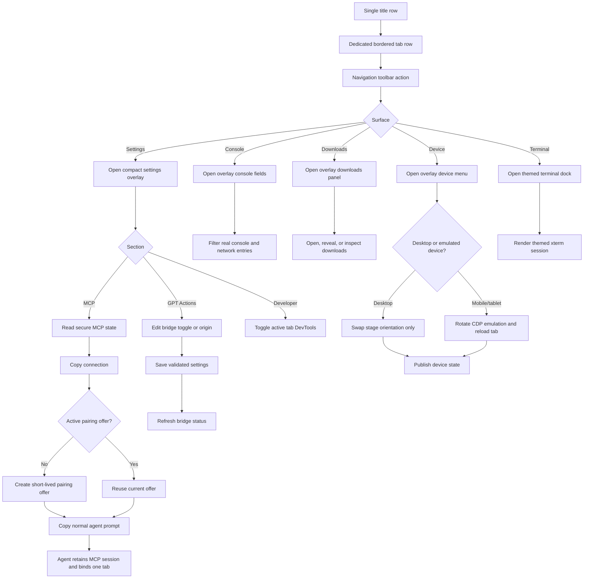

# Browser-use compact settings and chrome flowchart

## Purpose

The desktop shell keeps settings, downloads, console, terminal, and device controls
compact and visible above the managed BrowserView. MCP pairing remains secure and
agent copy produces ordinary prompt text with short-lived bootstrap guidance.

```text
+--------------------+
| Open settings      |
+---------+----------+
          v
+---------------------------+
| Compact section run       |
| MCP | GPT Actions | Dev   |
+----+----------+-----------+
     |          |
     v          v
+---------+  +----------------+
| MCP row |  | GPT row        |
| mode    |  | enabled/origin |
+----+----+  +-------+--------+
     |               |
     v               v
+----------------+  +----------------+
| Copy connection|  | Save settings |
| creates offer  |  | validate       |
| copies prompt  |  | refresh status |
+----------------+  +----------------+

+--------------------+       +----------------------+
| Toolbar action     | ----> | Overlay BrowserView |
| downloads/console  |       | topmost and themed  |
| device/terminal    |       +----------+-----------+
+--------------------+                  |
                                        v
                         +----------------------------+
                         | Render real state fields   |
                         | level, source, time, tab,  |
                         | URL, line, message        |
                         +----------------------------+

The single title row keeps File, Edit, View, Window first and the app icon/name
centered without overlap. A dedicated bordered tab row remains below it, followed
by the navigation toolbar. Tab and native view geometry use the same chrome height.
Rotate remains available for Desktop and swaps the stage orientation without
turning on mobile touch emulation.
```


