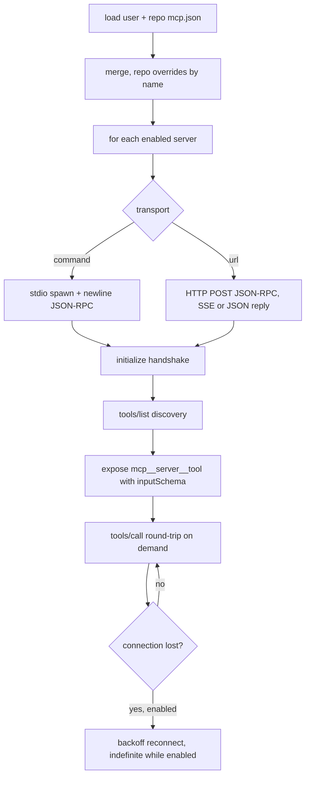
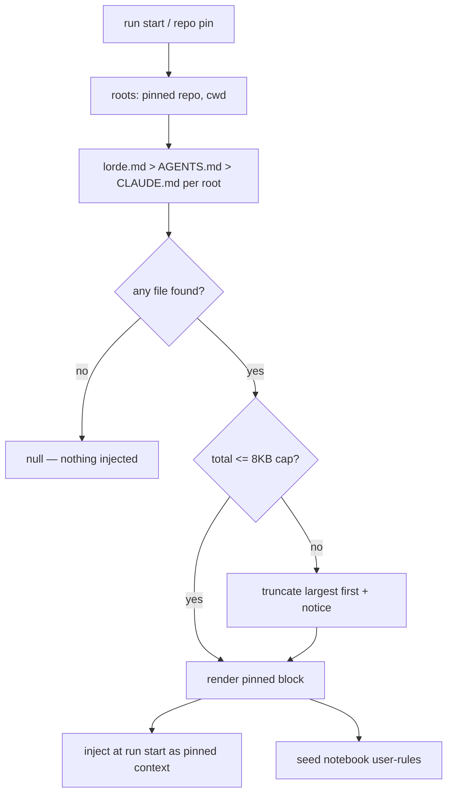

# GEN9 — Native /skills, /mcp, and Instruction-File Support

Flowchart-first design doc (per repo rule 0): every program added this round has its
ASCII + Mermaid flowchart below. This is the shared map for the skills manager, the
MCP client, and the instruction-file loader — plus the exact desktopChatAgent
integration stubs the follow-up agent wires.

## 0. Surface parity (owner directive)

EVERYTHING here serves BOTH surfaces from ONE implementation:

- The CLI (`/skills`, `/mcp` commands in cli/tui.mjs) and the desktop app
  (append-only IPC `browser-use:skills-manage` / `browser-use:mcp-manage` /
  `browser-use:instructions-load` in desktop/main.cjs) call the SAME three
  modules.
- Persistent scopes are shared on disk: a skill or MCP server installed via the
  CLI is immediately visible to the desktop app and vice versa
  (user-level `~/.browser-use-cli/skills/` + `~/.browser-use-cli/mcp.json`;
  repo-level `<repo>/.browser-use/skills/` + `<repo>/.browser-use/mcp.json`).
- Instruction-file loading happens ONCE at DesktopChatAgent's run start
  (both surfaces construct DesktopChatAgent). Until that stub is wired
  (Section 6), the CLI prepends the block at its composition root — marked
  `GEN9-INSTRUCTIONS` in cli/agent-cli.mjs — and that prepend is REMOVED in the
  same follow-up that wires the in-agent injection, so text is never injected twice.
- tests/gen9-skills.test.mjs asserts cross-surface discoverability explicitly:
  a manager constructed the way the desktop constructs it reads a skill the CLI
  installed into the shared user scope.

## 1. Survey — what already existed (and what was missing)

| Area | Existed | Gap filled this round |
|---|---|---|
| Skills | `desktop/record/skills.cjs` `SkillStore` — learned demonstrations (action/detail steps) in `userData/skills.json`; exposed to the agent ONLY through `skillsApi` built in desktop/main.cjs:679 (`search/run/feedback/digest`); agent tools `skill_search` / `skill_run` / `skill_feedback` in desktopChatAgent.cjs (lines 4169-4196, surface map 4641-4647); CLI passes `skillsApi: null` (cli/agent-cli.mjs ~490) | Skill PACKAGES: SKILL.md (frontmatter + body) + scripts/, installable from git URL / local folder / registry file, with user + repo scopes, enable/disable/remove/update — merged into the SAME skillsApi so `skill_search`/`skill_run` find them with zero desktopChatAgent changes |
| Knowledge | `desktop/knowledge/knowledgeStore.cjs` — durable facts (key/token/Jaccard recall), separate concern from skills | None (left untouched) |
| MCP | The app IS an MCP SERVER: `desktop/mcp/localMcpServer.cjs` (streamable HTTP, JSON-RPC 2.0, tools/list, tools/call); `mcp-config.example.json` documents EXTERNAL clients connecting to us | The MCP CLIENT side: app/CLI calling EXTERNAL servers (stdio + http), discovery via `tools/list`, namespaced tool exposure `mcp__<server>__<tool>`, per-server health, config scopes. Zero-dep JSON-RPC 2.0 over newline-delimited stdio and streamable HTTP |
| Instruction files | Nothing. `workspacePin.cjs` gives the pinned-repo concept (`/cd`, repo map, `renderRepoMapWire`); `--system-file` is a manual whole-prompt override | `instructionLoader.cjs`: lorde.md > AGENTS.md > CLAUDE.md at the pinned repo root (+ cwd fallback), 8KB cap with largest-first truncation + notice, notebook user-rules seeding hook |

## 2. Skill package format

```
<scope>/skills/<slug>/
  SKILL.md          # REQUIRED
  scripts/          # optional helper scripts the skill body may reference
```

SKILL.md:

```markdown
---
name: Post the weekly update
description: Publish the weekly metrics post to the drafting page
triggers: weekly update, publish post
apps: Chrome
domains: facebook.com
---
1. Open the drafting page ...
2. Paste the update text ...
```

- frontmatter keys: `name` (required), `description` (becomes `when`), `triggers`
  (comma-separated phrases), `apps`, `domains`, `version`.
- body = the instructions. Mapped to the SkillStore step shape as ONE step
  `{ action: 'Follow the skill instructions', detail: <body capped 6000>` } so the
  EXISTING `skill_run` handler (desktopChatAgent.cjs:4176) renders it unchanged.
- identity: `inst-<scope>-<slug>` (scope `user` | `repo`). State (enabled,
  usage/feedback, install provenance) lives in `<scope>/skills/.skills-state.json`
  — the SKILL.md itself is never mutated after install.

## 3. Skills manager flowchart

```text
+---------------------+    install source      +---------------------------+
| /skills install X   |----------------------->| classify: git URL |       |
| (CLI)               |                        | local dir | registry file |
| skills-manage IPC   |                        +------------+--------------+
+---------------------+                                     |
                          git clone --depth 1 (system git)  | copy tree   fetch/parse
                                     v                      v               v
                              +----------------------------------------------+
                              | stage skill dir (slug from name, dedup -2..) |
                              | validate SKILL.md (name present)             |
                              +----------------------+-----------------------+
                                                     | write .skills-state.json
                                                     v
                              +------------------------------+
                              | list()/search()/get() merge: |
                              |   repo scope beats user      |
                              |   enabled filter for search  |
                              +--------------+---------------+
                                             v
                     +-----------------------------------------------+
                     | createMergedSkillsApi(learnedStore?, manager) |
                     |  search: learned + installed, score-sorted    |
                     |  run(id): learned first, then installed       |
                     |  feedback(id): route to owning store          |
                     +-----------------------------------------------+
````

```mermaid
graph TD
  A[/skills install X] --> B{source kind}
  B -->|git URL| C[git clone depth 1]
  B -->|local dir| D[copy tree]
  B -->|registry| E[pick entry, recurse source]
  C --> F[stage skill dir + validate SKILL.md]
  D --> F
  E --> F
  F --> G[write scope .skills-state.json]
  G --> H[search/run via merged skillsApi]
  H --> I[skill_search finds it; skill_run loads body; skill_feedback updates usage]
```

## 4. MCP client flowchart

```text
+---------------------+   ~/.browser-use-cli/mcp.json
| config scopes       |   <repo>/.browser-use/mcp.json
| (shared both sides) |   merge: repo server name OVERRIDES user
+----------+----------+
           v
+-------------------------------+     per server: {command,args,env,cwd}  OR  {url,headers}
| McpRegistry (enable filter)   |
+--------------+----------------+
               v   connectAll()
   +---------------------------+      initialize -> notifications/initialized
   | transport: stdio (spawn)  |      tools/list -> tool catalog
   | or http (POST JSON-RPC,   |      health: connected|error|disconnected + toolCount + lastError
   | Accept json+event-stream) |
   +---------------------------+
               v
   namespaced tools: mcp__<server>__<tool>  (server name sanitized [A-Za-z0-9_-])
               v
   call(name,args) -> tools/call -> {content[], isError}
               v
   reconnect policy: unexpected stdio exit / transport error -> retry with
   backoff 1s,2s,4s... cap 60s, INDEFINITELY while enabled (owner directive:
   recovery is never terminated); explicit close() stops it.
```



## 5. Instruction files flowchart

```text
run start (or /cd pin)
        |
        v
+---------------------------------------------+
| roots = [pinned repo root, cwd]  (deduped)  |
+------------------+--------------------------+
                   v
      per root, FIRST existing of:
        lorde.md > AGENTS.md > CLAUDE.md
      (repo root wins; cwd used only if repo
       root has none)
                   |
                   v
+---------------------------------------------+
| total > 8192 chars? truncate LARGEST first, |
| each cut appends …[truncated: file capped   |
| at N of M chars] notice                     |
+------------------+--------------------------+
                   v
   block: "INSTRUCTION FILES (repo conventions —
   pinned context, not a user task):" + sections
                   |
                   v
   +---------------------------+   +------------------------------------+
   | CLI: prepend to task text |   | notebook user-rules seed rows:     |
   | (GEN9-INSTRUCTIONS mark,  |   | notebookUserRules(instructions) —  |
   | removed when stub lands)  |   | one capped row per file            |
   +---------------------------+   +------------------------------------+
```



## 6. desktopChatAgent integration stubs (follow-up wires these — file is OWNED
by the concurrent notebook agent until it lands)

STUB 1 — installed skills reach the agent (desktop side; CLI side is DONE in
cli/agent-cli.mjs):
- where: desktop/main.cjs `createChatAgent` (skillsApi literal, ~line 679).
- what: build `createSkillsManager({ userDir: path.join(os.homedir(), '.browser-use-cli', 'skills'), repoDir: pinnedRepoRoot ? path.join(pinnedRepoRoot, '.browser-use', 'skills') : null })` and replace the literal with
  `createMergedSkillsApi({ learnedStore: skillsStore, manager })` (same 4-method
  shape; zero desktopChatAgent changes needed).
- note: `run.completed` reinforcement (main.cjs:640) keeps working — merged
  `feedback` routes learned ids to SkillStore and installed ids to the
  manager's state file.

STUB 2 — MCP tools become agent tools:
- where: desktopChatAgent.cjs.
- what (three touch points):
  1. tool catalog: at run start, `registry.listTools()` rows join the TOOLS map
     — name `mcp__<server>__<tool>`, description from the server, input schema
     from `inputSchema` (JSON Schema passthrough).
  2. dispatch: in the action executor, before the fallthrough
     `Unsupported action`: `if (call.name.startsWith('mcp__')) return { ok: true, result: await run.mcpRegistry.call(call.name, call.input) }`.
  3. risk map: `mcp__*` defaults to `{ risk: 'external' }` (approval-gated like
     mutating tools) — add to READ_ONLY_ACTION_NAMES nothing; each server config
     may declare `"readOnlyTools": ["mcp__x__query"]` to relax.
- config rides the run: composition roots attach `mcpRegistry` to the run the
  way `skillsApi` is attached (`run.mcpRegistry`), so both surfaces share it.

STUB 3 — instruction files at run start (one loading point, both surfaces):
- where: desktopChatAgent.cjs run start, beside the skills-digest injection
  (after `appendConversationMessage(run, 'user', task)` ~line 1057).
- what:
  ```js
  try {
    const instructions = require('./instructionLoader.cjs').loadInstructionFiles({
      repoRoot: resolvedWorkspace?.root || '', cwd: process.cwd()
    });
    if (instructions) {
      appendConversationMessage(run, 'user', instructions.block, { source: 'runtime' });
      // Notebook seeding (persistent notebook feature):
      for (const row of notebookUserRules(instructions)) run.notebook?.addUserRule?.(row);
    }
  } catch { /* instructions must never block a run */ }
  ```
  `source: 'runtime'` keeps it out of the user's voice; because it is appended
  at run start it rides the same early region the skills digest rides.
  When this lands, REMOVE the GEN9-INSTRUCTIONS prepend in cli/agent-cli.mjs
  (single injection invariant).
- cap: 8192 chars total (instructionLoader default), largest-first truncation
  with an in-band notice, so provider ceilings are never threatened.

## 7. Files added/changed this round

| File | Kind |
|---|---|
| `desktop/agent/skillsManager.cjs` | new — skill packages, scopes, install/remove/update, merged skillsApi factory |
| `desktop/agent/mcpClient.cjs` | new — zero-dep MCP client (stdio + http), config scopes, registry, namespacing, reconnect |
| `desktop/agent/instructionLoader.cjs` | new — precedence, cap/truncation, notebook seeding hook |
| `desktop/skills_mcp_plan.md` | new — this doc |
| `cli/tui.mjs` | `/skills`, `/mcp` commands (picker-style listing + subcommands) |
| `cli/agent-cli.mjs` | merged skillsApi into the CLI agent; GEN9-INSTRUCTIONS task prepend |
| `desktop/main.cjs` | APPEND-ONLY: GEN9 IPC section (`browser-use:skills-manage`, `browser-use:mcp-manage`, `browser-use:instructions-load`) |
| `desktop/preload.cjs` | APPEND-ONLY: `skillsManage` / `mcpManage` / `instructionsLoad` renderer bindings for those channels |
| `tests/gen9-skills.test.mjs`, `tests/gen9-mcp.test.mjs`, `tests/gen9-instructions.test.mjs` | new tests |
| `tests/fixtures/mini-mcp-server.cjs` | new stdio MCP test fixture |

## 8. Verification contract

- `node --check` on every touched JS file.
- `node --test tests/gen9-skills.test.mjs tests/gen9-mcp.test.mjs tests/gen9-instructions.test.mjs` all green.
- Standing suites re-run to confirm no drift.
- After green: byte-identical mirror to `F:\harness-lab\browser-use` and
  `F:\harness-lab\gen8-share-arch2\cli` (CLI files), SHA256-verified, no execution there.
