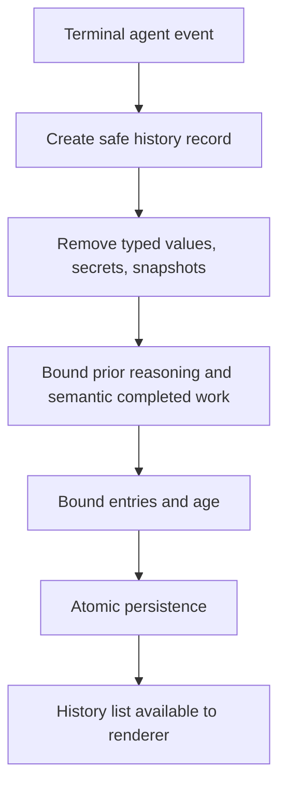
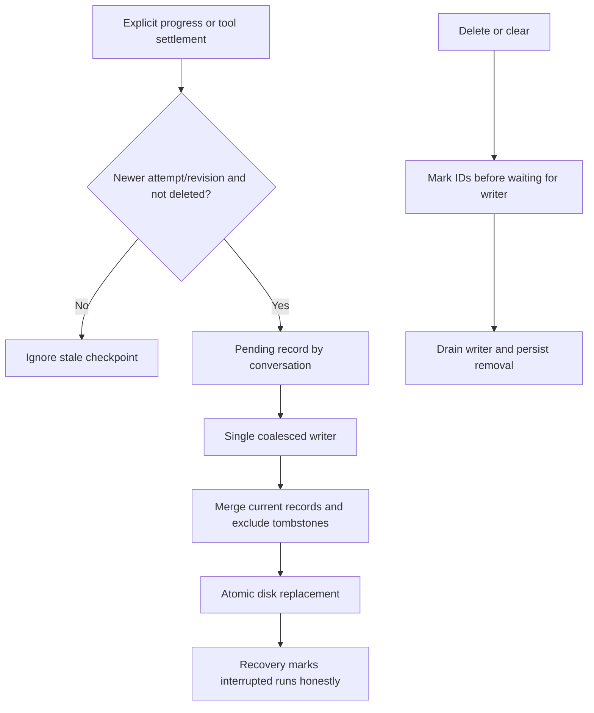
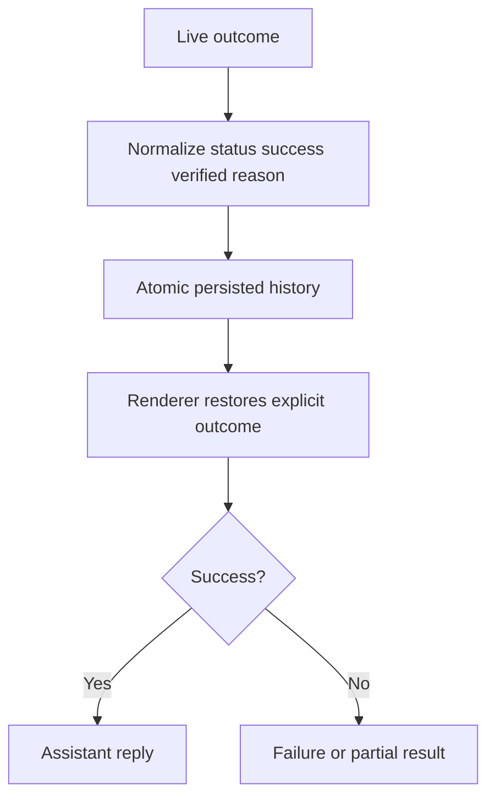

# Chat History Store Flowchart

```text
+--------------------+
| Terminal chat event |
+---------+----------+
          v
+--------------------+
| Redact and bound   |
| messages/transcript|
| plan/working state |
+---------+----------+
          v
+--------------------+
| Prune retention    |
+---------+----------+
          v
+--------------------+
| Atomic JSON write  |
+--------------------+
```



## Evidence domain continuity

Normal checkpoints also preserve an optional validated browser/computer observation domain. Old records remain compatible via their existing target URL; current Browser-only scope always overrides a saved native domain. Reopening captures current evidence rather than restoring old images. The complete startup/restore sequence is mapped in [Agent request and evidence efficiency](../agent/efficiency_flow_chat.md).

## Live checkpoint ordering

```text
+-------------------------+
| Meaningful agent event  |
+------------+------------+
             v
+-----------------------------+
| Compare attempt + revision  |
| Reject stale/deleted owner  |
+------------+----------------+
             v
+-----------------------------+
| Coalesce pending per ID     |
| One asynchronous writer     |
+------------+----------------+
             v
+-----------------------------+
| Merge still-current batch   |
| Atomic rename; keep IDs     |
+-----------------------------+

Delete/clear --> tombstone owner --> drain writer --> save removal
```



Live checkpoints preserve the existing 100-task contract, IDs, optional goals,
status and attempt/revision. A flushed revision remains the version floor;
an old event cannot become current merely because the pending queue is empty.
Deletion/clear is serialized after an active write, with tombstones preventing
late checkpoints from resurrecting history. Writes run only for meaningful
changes, never for thought tokens or spinner frames.

Only redacted, bounded conversation summaries are retained. The optional visible
plan remains conversation-owned. A separate small working-memory tail and
completed-work ledger are persisted so reopening a long chat keeps strategy
continuity without treating raw reasoning as verified fact.

## Durable outcome metadata

```text
+---------------------------+
| Live terminal outcome     |
| status/success/verified   |
| reason/summary            |
+-------------+-------------+
              v
+---------------------------+
| Redact and atomically save|
+-------------+-------------+
              v
+---------------------------+
| Restore exactly observed  |
| success and failure state |
+---------------------------+
```



Older records without a success field remain readable: only an old `completed` status is inferred successful, and verification remains false.
