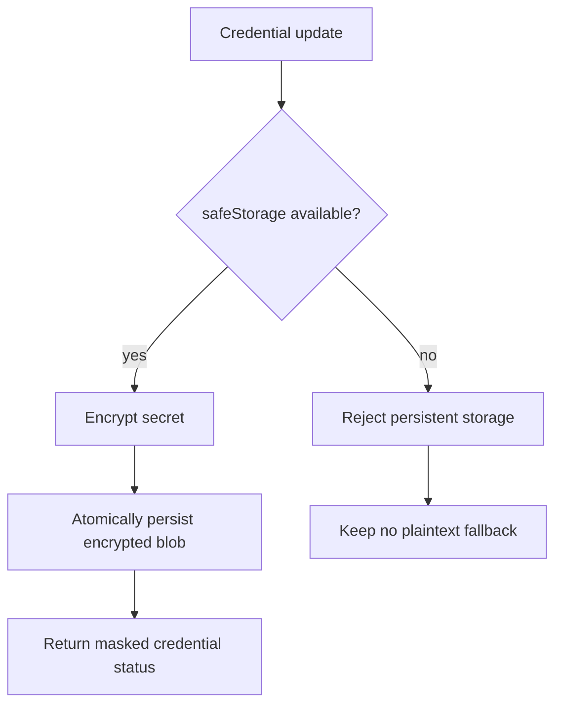

# Credential Store Flowchart

```text
+------------------+
| Settings request |
+--------+---------+
         v
+-----------------------+
| safeStorage available?|
+---+---------------+---+
    | yes           | no
    v               v
+--------+    +----------------+
| Encrypt |    | Report unavailable |
+---+----+    +----------------+
    v
+----------------------+
| Atomic encrypted file|
+----------------------+
```



Secrets never enter public settings or renderer state.
