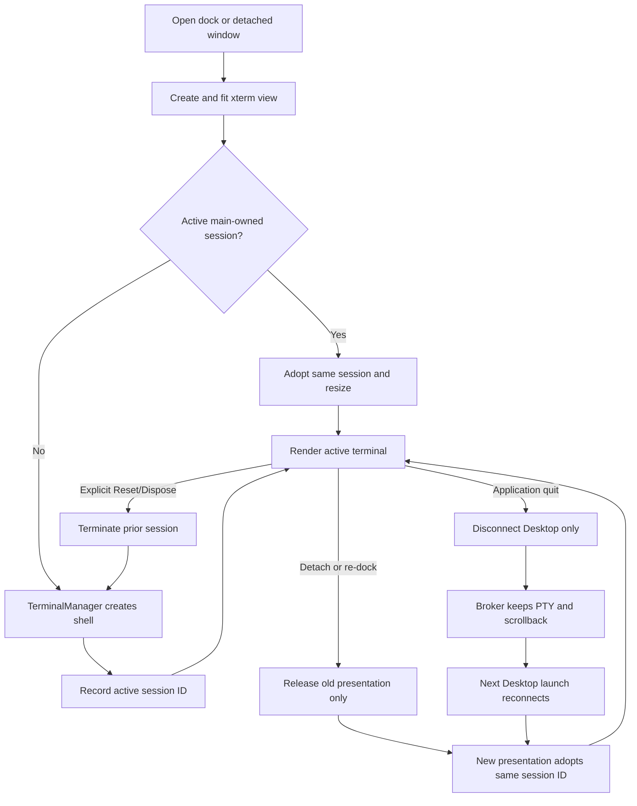
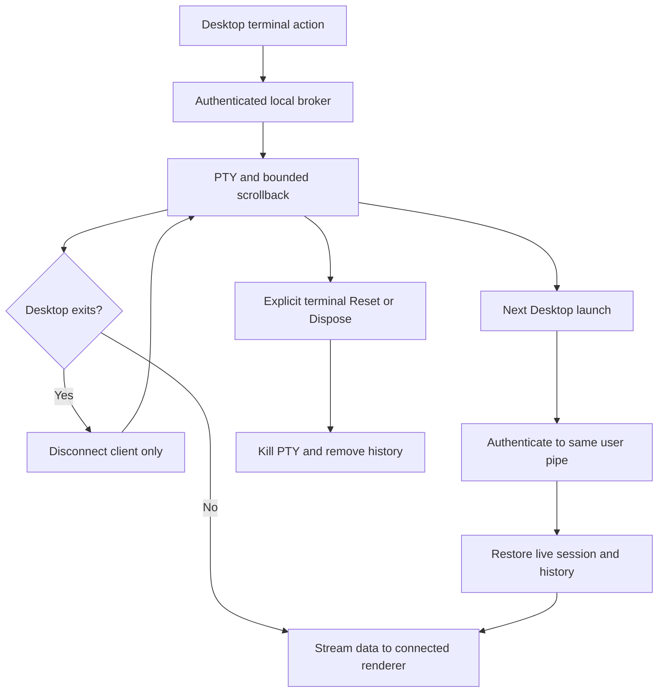
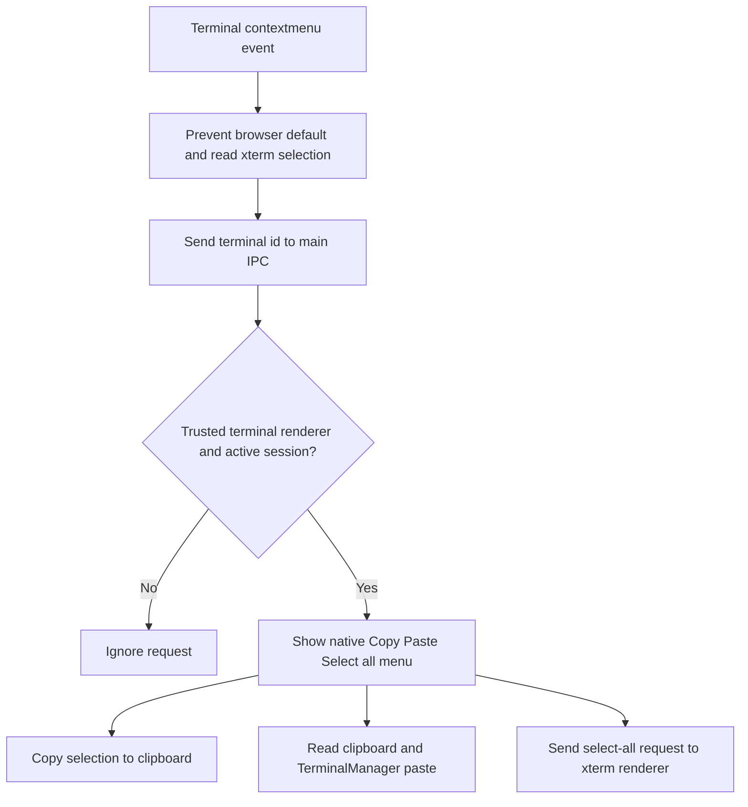
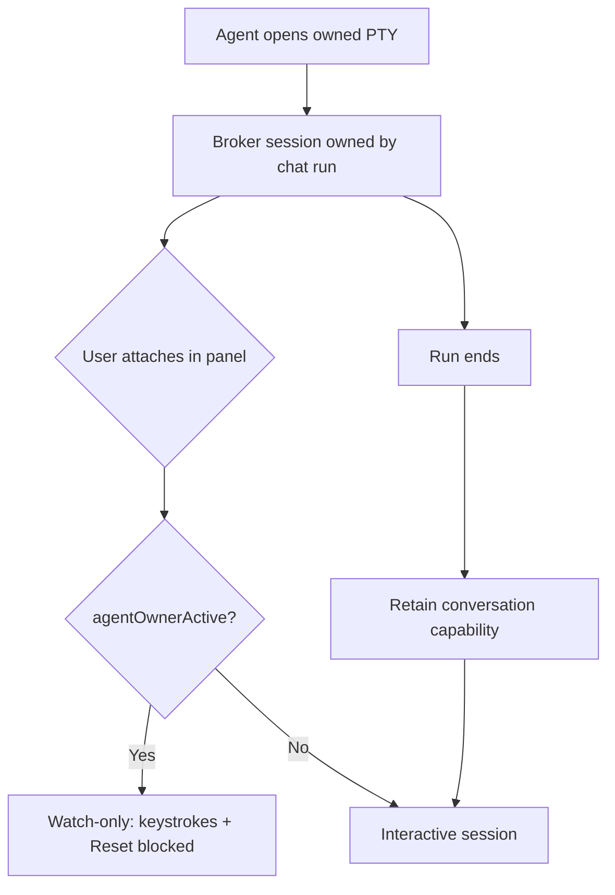
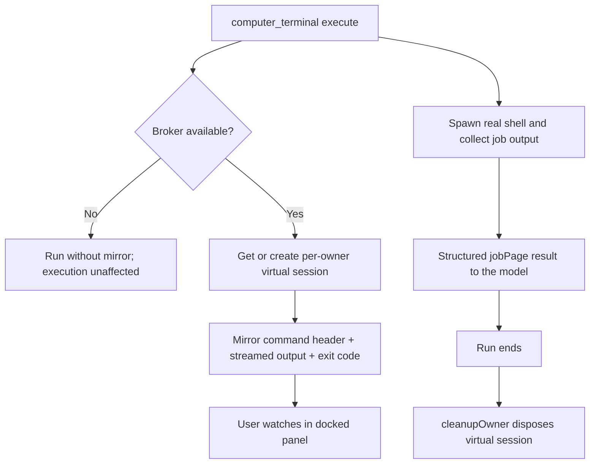
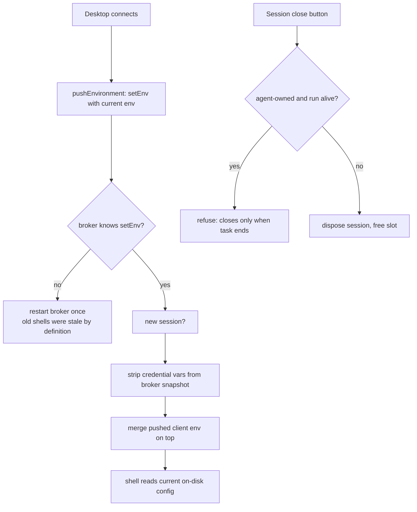
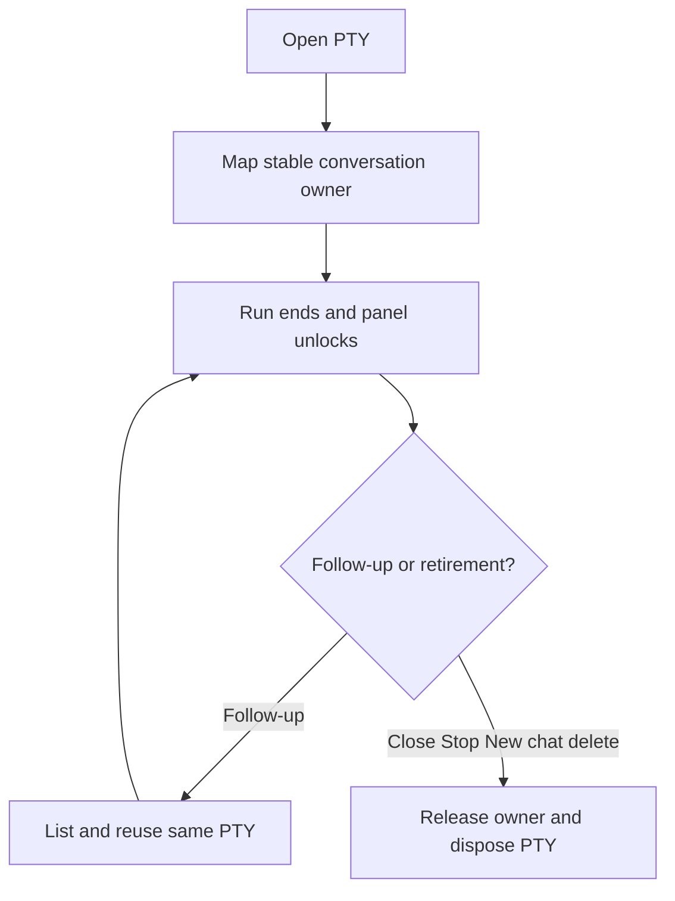
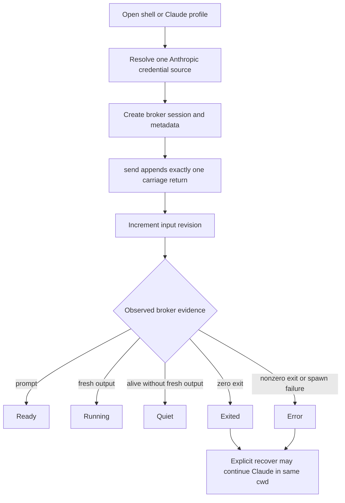

# Desktop terminal session and presentation flow

`TerminalManager` in the Electron main process owns the actual PTY or piped
shell. Docked and detached xterm renderers own only a presentation binding. A
presentation transition must never terminate the shell.

## Session transfer flow

```text
+------------------------+
| Terminal toolbar open  |
+-----------+------------+
            |
            v
+------------------------+
| Renderer opens xterm   |
+-----------+------------+
            |
            v
+-----------------------------+
| Main has active session?    |
+-------+---------------------+
+       | yes                         | no
+       v                             v
++----------------------+   +------------------------+
+| Adopt same session ID|   | Create session in      |
+| Resize to view       |   | TerminalManager        |
++----------+-----------+   +-----------+------------+
+           |                           |
+           +------------+--------------+
+                        |
+                        v
+             +------------------------+
+             | Docked or detached xterm|
+             +-----------+------------+
+                         |
+                 detach / re-dock
+                         |
+                         v
+             +------------------------+
+             | Release old view only  |
+             | Keep manager session   |
+             +-----------+------------+
+                         |
+                         v
+             +------------------------+
+             | New view adopts same ID|
+             +------------------------+
+
+Explicit Reset / Dispose
+                         |
+                         v
+             +------------------------+
+             | TerminalManager kills  |
+             | shell and emits exit   |
+             +------------------------+
+```



## Full application-close persistence flow

```text
+-------------------------+
| Electron creates/opens  |
| a terminal session      |
+------------+------------+
             |
             v
+-------------------------+
| Authenticated local     |
| terminal broker owns PTY|
+------------+------------+
             |
       app closes / quits
             |
             v
+-------------------------+
| Electron disconnects;   |
| broker does NOT kill PTY|
+------------+------------+
             |
             v
+-------------------------+
| Broker buffers output   |
| and keeps shell state   |
+------------+------------+
             |
       next app launch
             |
             v
+-------------------------+
| Authenticate, restore   |
| session status/history  |
+-------------------------+
```



## Terminal context-menu flow

```text
+-------------------------+
| Right-click xterm view  |
+-----------+-------------+
            |
            v
+-------------------------+
| Read xterm selection    |
| and active session ID   |
+-----------+-------------+
            |
            v
+-------------------------+
| Main validates trusted  |
| terminal renderer       |
+-----+--------------+----+
      |              |
      v              v
+-----------+  +---------------------+
| Copy text |  | Paste clipboard to  |
| selection |  | same shell session  |
+-----------+  +---------------------+
```



## Invariants

1. A shell session ID is created and owned by `TerminalManager`, never by an
   xterm renderer.
2. Detach, detached-window close, and re-dock move or remove presentation only;
   they do not call `dispose()` or `disposeAll()`.
3. An active session remains live and keeps shell state/history until explicit
   Reset/Dispose or natural child-process exit. App shutdown disconnects from
   the broker but must not terminate the shell.
4. A newly attached presentation resizes the adopted session to its own xterm
   geometry before accepting input.
5. A context-menu Paste writes only to the currently active main-owned session;
   a stale renderer cannot target a different shell. Copy uses only xterm's
   current selection, and Select all remains renderer-local until copied.
6. The broker accepts only clients presenting the per-user secret stored with
   the Desktop profile; it exposes no network listener and is reachable only
   through that local named pipe.

## Shell preference (2026-09-12)

`defaultShell()` moved to `desktop/terminal/shellPreference.cjs` and is shared
with the agent's `computer_terminal` execute path:

- PowerShell 7 (`pwsh` via where.exe) preferred when installed.
- Fallback 1: `COMSPEC` when it points at PowerShell.
- Fallback 2: `powershell.exe` (Windows built-in 5.1).
- Non-Windows: `$SHELL` or `/bin/bash`.

The PTY argument selection already covers pwsh (`/powershell|pwsh/i` keeps
`-NoLogo` interactive / `-NoLogo -NoProfile -Command -` piped invocation).
Same language either way, so agent command contracts are unchanged.

## Agent-owned sessions in the docked panel

The agent's `computer_terminal` `open/input/read/close` actions already ran
on the same broker as the panel. New wiring makes them visible and safe:

```
+------------------+ action=open  +------------------+
| Agent run        |-------------> | Broker session   |
| (chat:<runId>)   |               | owner=chat:<id>  |
+------------------+               +---------+--------+
                                             |
   browser-use:terminal-sessions             | listed with Agent badge
   browser-use:terminal-attach               v
+-----------------------------------------------------+
| Docked panel: watch the session (xterm adopt)       |
| readOnly=true while agentOwnerActive(owner)         |
| keystrokes refused; Reset and dispose are no-ops    |
+---------------------------+-------------------------+
                             | run.completed/failed/cancelled
                             v
          agentOwnerActive(owner) releases panel lock
          session becomes fully interactive for the user
```

- Input guard is enforced twice: the renderer refuses to send (readOnly) and
  the main-process `terminal-write` handler blocks writes to a session whose
  owning run is still alive (foreground or pool run).
- If the broker/PTY is unavailable the agent silently keeps its one-shot
  execute path; nothing about the session feature is mandatory.



## Virtual activity sessions (2026-09-13)

`execute` is the agent's one-decision path again. Previously the tool
description forced long-running or visible work through the multi-turn
`open` → `input` → `read` → `close` dance purely for visibility, which was
friction. Now every `execute` command and its streamed output are mirrored
into a **virtual** session so the user watches native work without the model
managing anything.

```text
+---------------------+ execute cmd  +----------------------+
| Agent shell()       |-------------> | activitySession()   |
| computer_terminal   |               | create(virtual:true)|
+---------+-----------+               +----------+----------+
          |                                      |
          | spawn real shell, pipe output        | virtual TerminalSession
          v                                      | (no process; write=emit)
+------------------+   append() -> mirrorWrite   |
| Job (output buf) |-----------------------------+
+------------------+   100ms throttled writeInput v
                                        +----------------------+
                                        | Broker history +     |
                                        | docked panel xterm   |
                                        | "Agent activity · …" |
                                        +----------+-----------+
                                                   | child close
                                                   v
                                        | "⏺ exit <code>" line |
          run ends: cleanupOwner disposes the virtual session
```



Contract:

- A virtual `TerminalSession` has `backend: 'virtual'`, `shell:
  'agent-execute'` and **no process**. `write()` emits to the view; the
  session never exits on its own — owner disposal is the only end.
- `ComputerTools.activitySession(ownerId, cwd)` lazily creates one virtual
  session per owner, reuses it across executes, and registers it in
  `this.terminals` so agent badging and `cleanupOwner` disposal apply.
- Mirroring is a visibility affordance: broker failures are swallowed and
  never break, delay, or alter execution or results.
- `computer_terminal` description now says execute IS the visible path;
  owned interactive PTY sessions are reserved for programs that need a live
  TTY/stdin (full-screen apps like claude code, prompts, driven watchers) —
  never merely for visibility.
- Renderer `sessionLabel` renders virtual sessions as `Agent activity · …`.

### Input submission contract (2026-09-13)

Two live-run regressions shaped this contract; both made the agent burn
decisions staring at a bare prompt:

1. **`open` dropped the command.** `action=open` accepted a `command` argument
   and silently ignored it — the session sat at a bare PowerShell prompt and
   the model read it three times before trying to retype. Now open+command
   submits immediately (`command\r`), waits `waitMs` (default 3000), and
   returns post-launch history plus a `launched` field.
2. **A bare LF did not submit.** The Enter key sends CR; PSReadLine treats a
   bare LF as "insert newline", so a model-typed `claude\n` became a `>>`
   continuation buffer instead of a command. The PTY write path now
   translates `\r?\n` → `\r` (in `TerminalSession.write`), so programmatic
   input submits like a keypress. The piped backend's line editor already
   treated LF as Enter; the virtual backend is unaffected (mirror formatting
   keeps its `\r\n`).

`input` and open-with-command settle briefly before returning history
(defaults 500ms/3000ms, tunable via `waitMs`), so the returned snapshot shows
what actually happened rather than the pre-input screen.

## Fresh environment, closable sessions (2026-09-14)

Three user-facing defects fixed: terminals could not be closed, new/reset
terminals kept a stale API key (config fixed on disk kept losing to an
inherited env snapshot), and Reset behaved like a viewport clear.

```
+---------------------------+ app (re)connect +---------------------------+
| Desktop main process      |---------------->| Terminal broker (detached)|
| current process.env       |    setEnv       | clientEnvironment stored  |
+---------------------------+                 +------------+--------------+
                                                           |
                              Reset or new terminal        |
                                             +-------------v-------------+
                                             | create():                 |
                                             |  host snapshot (broker)   |
                                             |   minus credential vars   |
                                             |   (ANTHROPIC_API_KEY,     |
                                             |    *_AUTH_TOKEN, *_BASE_URL...)|
                                             |  then clientEnvironment   |
                                             |   wins                    |
                                             +---------------------------+
```



Invariants added:

7. A terminal session's environment is built fresh at spawn: the broker's own
   (possibly days-old) snapshot loses every credential-shaped variable — exact
   names (`ANTHROPIC_API_KEY`, `ANTHROPIC_AUTH_TOKEN`, `*_BASE_URL`, ...) and
   the `*_API_KEY` / `*_AUTH_TOKEN` / `*_API_TOKEN` / `*_BASE_URL` suffix
   families — while the Desktop-pushed environment (`setEnv`, sent on every
   connect) wins on top. A dropped-from-host key that is not re-supplied is
   announced in the terminal as a dim `[environment]` notice.
8. An old broker that predates `setEnv` is restarted once by the client: its
   shells predate the strip and could never honor fresh config.
9. Every listed session is closable from the terminal header (X button).
   Closing an agent-owned session whose run is alive is refused in both the
   renderer and the main-process dispose handler — the owner-release path
   disposes it deliberately instead.
10. Reset disposes the old shell and spawns a new one that inherits the
    freshest pushed environment — never a mere viewport clear.

## Conversation-scoped interactive control

A completed chat turn no longer deletes the stable `chat:<conversationId>` PTY capability. `agentOwnerActive()` controls the panel's write lock only while that turn runs. The next continuation lists the existing session and resumes `read/input`; a duplicate `open` reuses the session unless `newSession:true` is explicit. Explicit close, Stop, New chat, history deletion, and panel disposal remove the capability and terminate the process. A normal Desktop restart keeps broker-owned scrollback by design and returns that process to manual terminal control; conversation ownership is not silently reconstructed across process restarts. A background `execute` still uses a view-only virtual session.

```text
+----------------------+      +-------------------------+
| Open interactive PTY | ---> | Map chat ID to PTY ID   |
+----------------------+      +------------+------------+
                                         |
                                         v
                            +-------------------------+
                            | Chat turn completes     |
                            | panel input unlocked    |
                            | capability retained     |
                            +------------+------------+
                                         |
                                         v
                            +-------------------------+
                            | Continuation lists and  |
                            | controls same PTY       |
                            +------------+------------+
                                         |
                                         v
                            +-------------------------+
                            | Close/Stop/retire cleans|
                            +-------------------------+
```



## Acknowledged input, deterministic auth, and lifecycle state

```text
+---------------------------+
| Open shell / Claude Code  |
+-------------+-------------+
              v
+---------------------------+
| Resolve one credential    |
| source for child only     |
+-------------+-------------+
              v
+---------------------------+
| Broker creates session    |
| phase=starting, rev=0     |
+-------------+-------------+
              v
+---------------------------+
| send(text) appends one CR |
| inputRevision increments  |
+-------------+-------------+
              v
+---------------------------+
| Output / prompt / exit    |
| updates outputRevision    |
+------+--------------------+
       |
       v
+---------------------------+
| Return acknowledgement    |
| ready/running/quiet/error |
+---------------------------+
```



The broker retains bounded exit history as a tombstone until explicit close or recovery. Renderer, agent, and terminal picker consume the same phase and revision fields; no layer infers completion from process existence alone.
