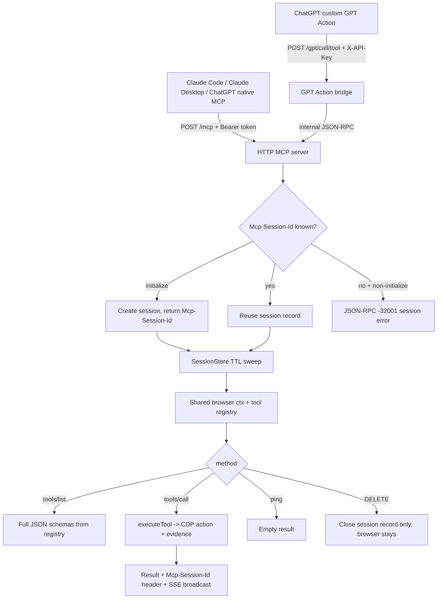
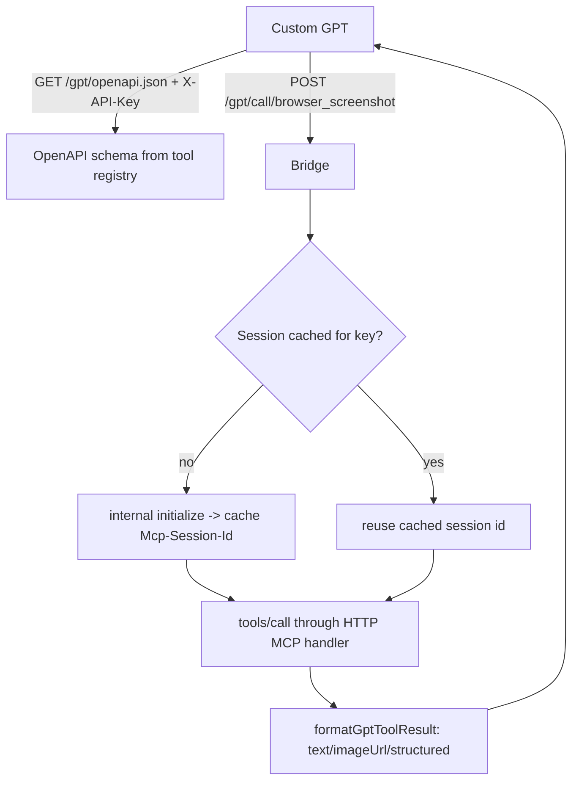

# Browser-use session-based MCP (HTTP) — flowchart

## Purpose

Upgrade Browser-use MCP from ephemeral stdio spawning (a fresh process + fresh browser for every MCP client connection) to the same session-persistent architecture already proven in LordeDesign Studio's `McpSession` Durable Object (`studios/src/worker.js`):

1. **One long-lived local MCP HTTP service** owns one persistent browser runtime.
2. **Standard Streamable HTTP MCP** at `POST/GET/DELETE /mcp` with `Mcp-Session-Id` headers, so any MCP client (Claude Code, Claude Desktop, ChatGPT native MCP connector) reconnects to the same live browser session instead of relaunching Chromium.
3. **ChatGPT GPT Action bridge** at `/gpt/openapi.json` + `/gpt/call/<tool>` with `X-API-Key`, mirroring the Studio's `gptBridgeCore.mjs` contract, so custom GPTs can drive the same session.
4. **stdio `--mcp` stays supported** for backward compatibility, but is corrected so it never binds the control-center HTTP port (root cause of the `EADDRINUSE :::8765` crashes in `browser-use.log`).

## Problems in the previous configuration

```text
+---------------------------+       +---------------------------+
| MCP host (.mcp.json)      |       | Second MCP host           |
| spawns browser-use --mcp  |       | spawns browser-use --mcp  |
+------------+--------------+       +------------+--------------+
             |                                   |
             v                                   v
+---------------------------+       +---------------------------+
| NEW node process          |       | NEW node process          |
| NEW Chrome + NEW session  |       | tries ws port 8765        |
| (state lost on disconnect)|       | -> EADDRINUSE crash       |
+---------------------------+       +---------------------------+
```

- No session identity: `initialize` returns no `Mcp-Session-Id`; nothing survives a reconnect.
- Every client = separate Chromium; diagnostics, action trace, and page state are lost between calls from different hosts.
- `main()` started the WebSocket control server even in `--mcp` stdio mode, so a second spawn crashed with `EADDRINUSE`.
- No ChatGPT path at all (neither native MCP connector nor GPT Action).

## Upgraded architecture

```text
                    +--------------------------------------------+
                    | browser-use --mcp-http  (long-lived daemon)|
                    |                                            |
 Claude Code  ----> |  POST /mcp  (JSON-RPC, Bearer token)       |
 Claude Desktop --> |  GET  /mcp/sse (SSE stream)                |
 ChatGPT MCP  ----> |  DELETE /mcp (close session)               |
                    |          |                                 |
 ChatGPT GPT  ----> |  GET  /gpt/openapi.json  (X-API-Key)       |
 Action       ----> |  POST /gpt/call/<tool>   (X-API-Key)       |
                    |          |                                 |
                    |          v                                 |
                    |  +---------------------+                   |
                    |  | SessionStore        |                   |
                    |  | Mcp-Session-Id ->   |                   |
                    |  | { createdAt, ttl,   |                   |
                    |  |   initialized }     |                   |
                    |  +----------+----------+                   |
                    |             |                              |
                    |             v                              |
                    |  +---------------------+                   |
                    |  | ONE shared runtime  |                   |
                    |  | ctx: CDP browser,   |                   |
                    |  | diagnostics, trace, |                   |
                    |  | event bus, registry |                   |
                    |  +----------+----------+                   |
                    +-------------|------------------------------+
                                  |
                                  v
                    +---------------------------+
                    | Persistent visible Chrome |
                    | (survives reconnects)     |
                    +---------------------------+
```



## Session lifecycle

```text
initialize  -> create { id: sess-<uuid> }        -> respond with Mcp-Session-Id header
tools/*     -> require valid session id header   -> touch lastSeenAt, extend TTL
DELETE /mcp -> drop the session record           -> browser + runtime stay alive
TTL sweep   -> sessions idle beyond TTL removed  -> browser + runtime stay alive
shutdown    -> SIGINT/SIGTERM on the daemon      -> browser tree killed once
```

Sessions are metadata only — the browser is owned by the daemon, exactly like the
Studio DO owns one connected Studio tab per key. Any number of MCP sessions can
observe/drive the same live browser; the last writer wins, mirroring the Studio
"one browser link, many client requests" model.

## Auth model (mirrors the Studio)

- `POST /mcp/token` with `{ key }` returns a signed short-lived bearer token
  (HMAC-SHA256, same JWT shape as `signMcpJwt` in `worker.js`); secret comes from
  `BROWSER_USE_MCP_SECRET` (or is generated per-daemon and printed at startup).
- All `/mcp` traffic requires `Authorization: Bearer <token>`.
- `/gpt/*` requires `X-API-Key: <key>` — the bridge signs its own internal token,
  identical to the Studio GPT bridge proxying through the DO.
- Loopback-only bind by default (`127.0.0.1`), rate-limited per address.

## GPT Action bridge flow



## Invariants

1. One daemon = one persistent browser runtime; reconnecting MCP clients never relaunch Chromium.
2. `initialize` always returns an `Mcp-Session-Id` header; every subsequent response echoes it.
3. Non-initialize requests without a known session id fail with JSON-RPC `-32001` (client then re-initializes — this is the retry contract the Studio GPT bridge already implements).
4. stdio `--mcp` mode never binds an HTTP/WS port.
5. `/gpt` and `/mcp` expose the same tool registry and the same JSON schemas — no drift.
6. Only loopback binds by default; non-loopback requires explicit `--mcp-host`.
7. All acceptance checks run a genuine Chromium process — no mocked CDP.
