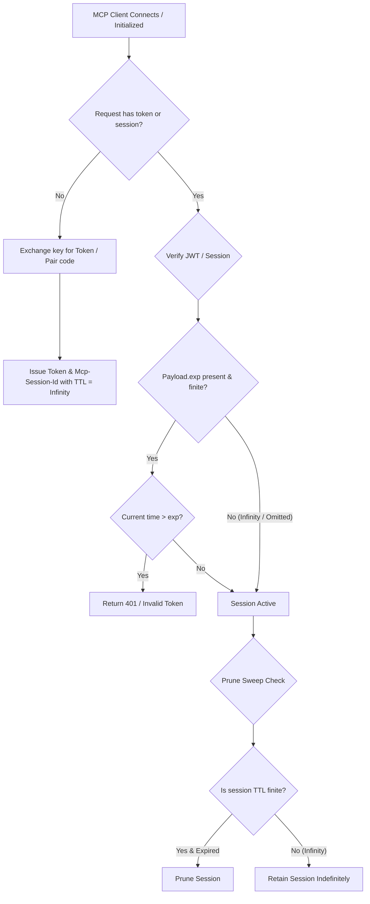
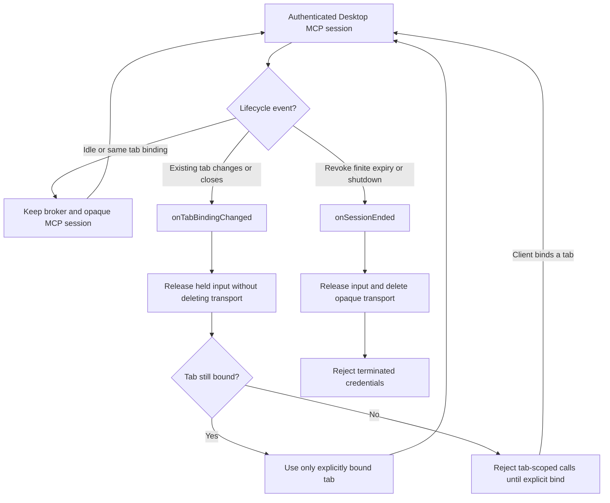

# MCP Non-Expiring Connection & Session Flowchart

## Overview

This document specifies the non-expiring MCP connection and session architecture for both the `browser-use` runtime (stdio & Streamable HTTP MCP) and the LordeDesign Studio backend (`worker.js`).

MCP sessions and JWT bearer tokens now set session TTL to `Infinity` by default. Session prune sweeps ignore non-expiring sessions (`Number.isFinite(ttlMs)` checks), ensuring MCP connections remain active indefinitely until explicitly revoked or closed by the client or host.

```text
+-----------------------------------------------------------------------+
|                       MCP Connection & Auth                           |
+-----------------------------------------------------------------------+
                                    |
                                    v
+-----------------------------------------------------------------------+
|  Initialize / Token Generation                                        |
|  - sessionTtlMs = Infinity                                            |
|  - ttlSeconds = Infinity (omit 'exp' claim in JWT)                     |
+-----------------------------------+-----------------------------------+
                                    |
                                    v
+-----------------------------------------------------------------------+
|  Session Store / Session Broker / Pairing Service                      |
|  - Active sessions stored in Map                                      |
|  - expiresAt = Infinity                                               |
+-----------------------------------+-----------------------------------+
                                    |
                                    v
+-----------------------------------------------------------------------+
|  Prune & Verification Sweep                                           |
|  - Check: Is Number.isFinite(session.expiresAt)?                      |
|    - YES (finite): If session.expiresAt <= now, prune session        |
|    - NO (Infinity): Retain session indefinitely                       |
|  - Check: Is payload.exp defined and Number.isFinite(payload.exp)?    |
|    - YES (finite): If exp < now, reject token                         |
|    - NO (undefined/Infinity): Token remains valid                     |
+-----------------------------------+-----------------------------------+
                                    |
                                    v
+-----------------------------------------------------------------------+
|  Session Remains Active Indefinitely (Never Expires)                  |
+-----------------------------------------------------------------------+
```



## Detailed Rules

1. **SessionStore (`tools/browser-use/src/mcp/sessionStore.js`)**:
   - `DEFAULT_SESSION_TTL_MS = Infinity`
   - `prune()` skips purging when `!Number.isFinite(this.ttlMs) || this.ttlMs <= 0`.

2. **mcpAuth (`tools/browser-use/src/mcp/mcpAuth.js`)**:
   - `DEFAULT_TOKEN_TTL_SECONDS = Infinity`
   - `signMcpToken`: Omits `exp` payload claim when `ttlSeconds` is `Infinity` or non-finite.
   - `verifyMcpToken`: Validates `payload.exp` only if present and `Number.isFinite(payload.exp)`.

3. **PairingService (`tools/browser-use/src/pairing/pairingService.js`)**:
   - `DEFAULT_SESSION_TTL_MS = Infinity`
   - `prune()` validates `Number.isFinite(session.expiresAt)` before revoking expired sessions.

4. **SessionBroker (`tools/browser-use/desktop/mcp/sessionBroker.cjs`)**:
   - `DEFAULT_SESSION_TTL_MS = Infinity`
   - Constructor allows `sessionTtlMs === Infinity`.
   - `pruneExpired()` checks `Number.isFinite(session.expiresAt)`.
   - `isPairingRecoverable` handles `recoveryExpiresAt === Infinity`.

5. **Cloudflare Worker MCP (`studios/src/worker.js`)**:
   - `signMcpJwt`: Default `ttlSeconds = Infinity`. Omits `exp` claim when infinite.
   - `verifyMcpJwt`: Validates `payload.exp` only when present and `Number.isFinite(payload.exp)`.

## Desktop binding lifecycle repair (2026-09-10)

### Audit and intended boundary

The Desktop broker default is already `Infinity`; pairing offers still expire after
five minutes and must not become permanent credentials. The disconnect path was
not an idle timer: `bindTab()` called `onSessionEnded` when moving an existing
binding from tab A to tab B. The Desktop callback then called
`LocalMcpServer.forgetBrokerSession()`, deleting the opaque transport even though
the broker session remained authenticated. The bind request could succeed, but
the following request with that same `Mcp-Session-Id` failed as unknown/expired.
Once the short-lived pairing offer expired, replaying it could not recover.

Target changes and actual session termination now have separate callbacks:
`onTabBindingChanged` releases held input but keeps the opaque MCP session;
`onSessionEnded` releases held input and removes the transport only for revoke,
finite expiry, or shutdown/revoke-all. Closing a bound tab unbinds it and releases
its held input without ending authentication. A later tab-scoped call fails until
the client explicitly binds another tab; it never silently chooses a target.

The dispatcher also lacked a standard `ping` response. Authenticated heartbeats
now return `{}` through the existing session-authentication branch rather than
`Method not found`. No heartbeat changes a binding or refreshes pairing expiry;
missing, unknown, and revoked credentials still fail closed. Its request flow is
mapped in `desktop/mcp/localMcpServer_flow_chat.md`. This prevents an unsupported
heartbeat from becoming an additional reconnect trigger; it is not proof that a
particular external host's observed disconnect was caused by ping.

```text
+----------------------------------------+
| Authenticated Desktop MCP session      |
| default expiresAt = Infinity           |
+-------------------+--------------------+
                    |
                    v
+----------------------------------------+
| Which lifecycle event occurred?        |
+------+------------------+--------------+
       |                  |                         |
       v                  v                         v
+----------------+ +----------------------+ +----------------------+
| Idle or same   | | Existing tab changes | | Revoke, finite expiry|
| tab bind       | | or bound tab closes  | | or shutdown          |
+-------+--------+ +----------+-----------+ +----------+-----------+
        |                     |                        |
        v                     v                        v
+----------------+ +----------------------+ +----------------------+
| No teardown    | | onTabBindingChanged  | | onSessionEnded       |
| Keep session   | | Release held input   | | Release held input   |
+----------------+ | Keep Mcp-Session-Id   | | Delete transport     |
                   +----------+-----------+ +----------------------+
                              |
                              v
                   +----------------------+
                   | Next call uses same  |
                   | opaque session; tab  |
                   | must still be bound  |
                   +----------------------+
```



### Regression coverage

- Use the real broker and `LocalMcpServer.handleMcp()` with in-memory HTTP
  responses, fake controller input ownership, and no live Desktop connection.
- Keep one opaque session across A → B → A, close/unbind, and explicit rebinding;
  release held input on each previous-target change and reject revoked sessions.
- Advance the injected broker clock beyond five minutes and by a year: the
  pairing header expires, while the default broker session and retained opaque
  transport still authenticate and answer `ping`. Explicit finite TTL sessions
  must still expire.
- Heartbeats return the same opaque session and empty result without requiring
  a bound tab; missing credentials, unknown IDs, and revoked sessions remain
  rejected.
- Browser minimization/focus is a separate Electron lifecycle concern, not an
  instruction to recreate an MCP session or extend pairing credentials.
