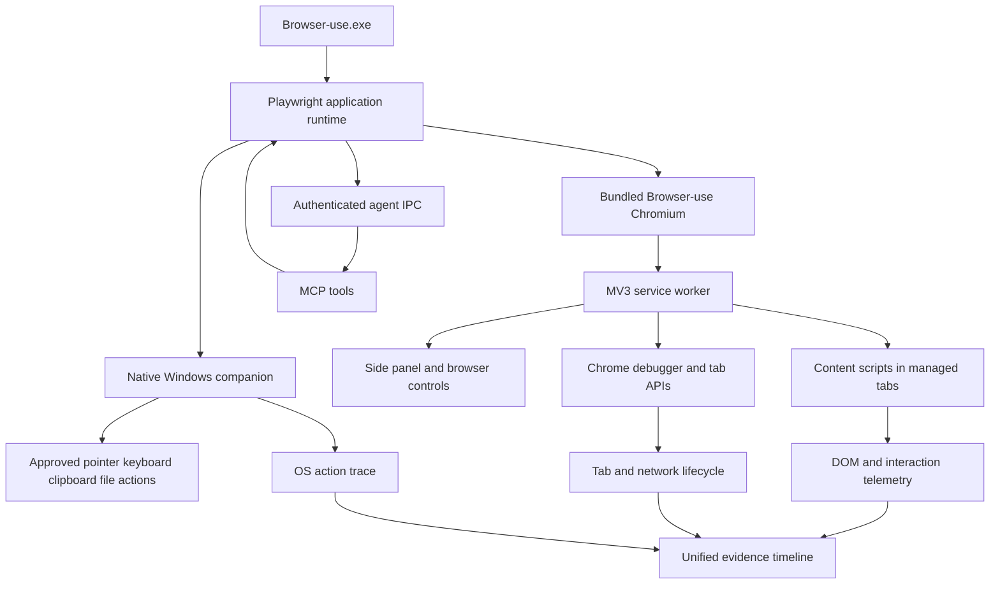
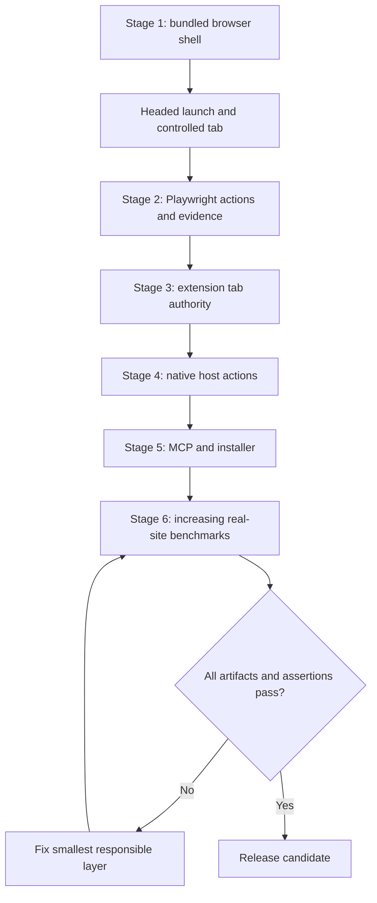

# Browser-use custom Playwright browser application — flowchart

## Objective

Replace the profile-based CDP wrapper with a dedicated Windows Browser-use desktop product. The executable owns the automation runtime and launches a bundled Chromium channel controlled through Playwright. A browser-native extension handles tab lifecycle and page observation; the local native companion exposes explicitly approved Windows actions and low-latency agent IPC.

## Architecture flow

```text
+-----------------------+
| Browser-use.exe        |
| Windows application    |
+-----------+-----------+
            |
            v
+-----------------------+       +--------------------------+
| App runtime            |------| Local authenticated IPC  |
| Playwright controller  |      | MCP / named pipe / WS    |
+-----------+-----------+       +--------------------------+
            |
            v
+-----------------------+
| Bundled Chromium      |
| Browser-use channel   |
+-----+-----------+-----+
      |           |
      v           v
+----------+  +------------------------+
| Extension|  | Native companion host  |
| MV3      |  | Windows permission APIs|
+----+-----+  +------------------------+
     |
     v
+-----------------------+
| Every managed browser |
| tab, frame, download, |
| console/network event |
+-----------------------+
```



## Lifecycle

```text
Install Browser-use
  -> register native host and extension policy
  -> store signed/bounded runtime assets
  -> Browser-use.exe starts
  -> validate bundled Chromium + extension
  -> start authenticated local agent bridge
  -> launch browser window
  -> extension announces browser/tab readiness
  -> agent sends browser command
  -> app routes to Playwright, extension, or native companion
  -> record screenshot, page state, console, network, and OS evidence
```

## Security and permission decisions

1. Browser-use manages only its own bundled Chromium session by default.
2. Every localhost/MCP client authenticates with a rotating session token.
3. Native actions are allowlisted and recorded; no arbitrary shell execution comes from pages or extension messages.
4. File picker, clipboard, downloads, and browser debugging follow explicit browser/Windows permission prompts or installer-approved scopes.
5. The extension has no unrestricted authority over personal Chrome profiles; managed Browser-use Chromium is the product boundary.

## Staged validation


