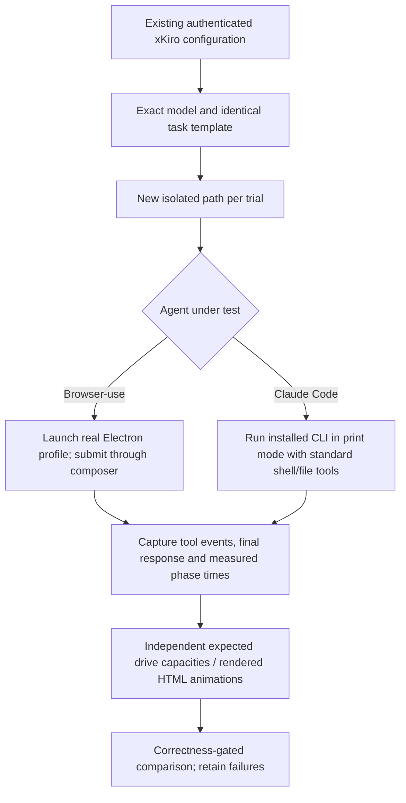

# Same-model agent comparison

```text
+-------------------------------+
| Exact xKiro model + credential|
| Equivalent tasks / new files  |
+---------------+---------------+
                v
+-------------------------------+
| Alternate sequential trials  |
| No concurrent desktop agents |
+-------+----------------+------+
        v                v
+---------------+ +----------------------+
| Browser-use UI| | Real Claude Code CLI |
| Existing loop | | Default agent prompt |
+-------+-------+ +----------+-----------+
        +------------------+
                    v
       +----------------------------+
       | Verify disk bytes / HTML  |
       | Save raw local evidence   |
       +-------------+--------------+
                     v
       +----------------------------+
       | Compare success first     |
       | Time, turns, tools, errors|
       +----------------------------+
```



The CLI is not a replacement stub. It keeps its normal system prompt and loop;
`--safe-mode` disables unrelated local plugins/hooks, not built-in tools. Only
the shell/file tool families used by these benchmarks are exposed/approved.
Both agents may execute real commands and write their own new fixture files.
No forced reasoning length, task plan, scripted model response or task-performing
helper is supplied. The deadline is the same four-minute evaluation cutoff, not
a production reasoning cap. The agents retain different native provider
protocols/default context/token settings; report that limitation instead of
claiming identical inference configuration.

Measure elapsed wall time from submission/invocation to final result, actual
model turns (unique assistant message IDs and reported turn count for CLI),
operation names/counts, failed tools, repeated identical invocations and final
success. Exclude harness setup from Browser-use task time; separately report CLI
startup-to-init time so startup overhead is not mistaken for model inefficiency.
Token/cost values, when returned, are estimates; do not manufacture missing data.
Repeated runs alternate order and run sequentially to reduce contention. Verify
correctness before comparing speed. Local logs only; no Braintrust-hosted upload.
