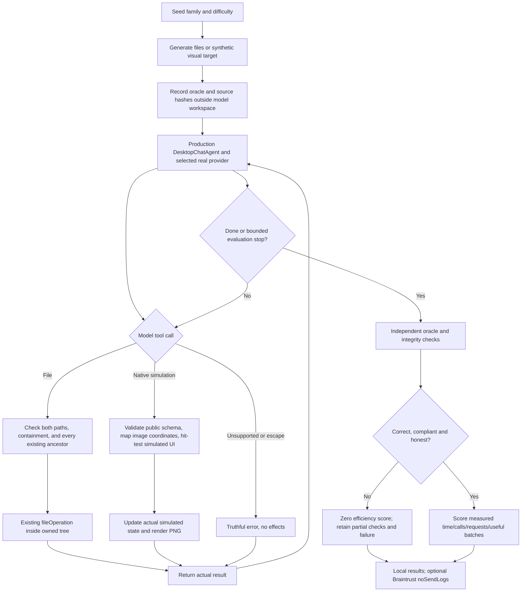

# Real-provider sandbox campaign

This evaluator uses the production DesktopChatAgent and provider. Only environment effects are isolated. All scored decisions are model-generated; no action sequence is injected. Unit tests of the evaluator are not quality runs.

```text
+---------------------------+
| Frozen seed/family/level  |
+-------------+-------------+
              v
+---------------------------+
| New owned directory       |
| Generated sources + oracle|
+-------------+-------------+
              v
+---------------------------+
| Production agent/provider |<---- existing xKiro model
| No benchmark-only planner |
+-------------+-------------+
              v
+---------------------------+
| Sandbox dispatch boundary |
+------+------+-------------+
       | files         | visual
       v               v
+--------------+ +------------------------+
| Scoped real  | | Stateful synthetic app |
| fileOperation| | Hit tests / strokes    |
| no symlinks  | | Rendered PNG evidence  |
+------+-------+ +-----------+------------+
       +--------------------+
                  v
+----------------------------------------+
| Real tool result + next model decision |
| No host native/shell/clipboard access   |
+-----------------+----------------------+
                  v
+----------------------------------------+
| Independent state/content/source checks|
| Correctness gate -> efficiency score   |
+-----------------+----------------------+
                  v
+----------------------------------------+
| Local traces + frozen dev/holdout split|
| Baseline -> one candidate -> comparison|
+----------------------------------------+
```



## File boundary

Absolute paths must resolve inside the fresh workspace (`path.relative` cannot start with `..` or be absolute). Check every existing ancestor with lstat and reject symlinks, including destinations and parents for future files. No concurrent external writers are part of this test environment. This is an evaluation-only boundary, not a security claim for arbitrary hostile host processes. Never invoke shell/native/clipboard from the sandbox. Unsupported actions do not receive pretend successful output. Exact file results reuse production implementation.

## Visual simulation

Synthetic window, toolbar, orientation dialog, explicit colors, and a drawing region. Pointer events hit-test actual rectangles; selected tool/color and strokes persist. Model must inspect rendered pixels; hidden expected points are never supplied as tool metadata. Fresh screenshot IDs and scaling use production mapping helpers. The reference is seeded geometric art, not a portrait or a Paint manual. PNG rendering uses a hidden isolated Electron window, not desktop capture. State transitions happen only through model-issued supported tools. Sequential delays and seeded errors are recorded as injection, not real OS behavior.

## Scoring

Frozen budgets per case define time, calls and provider requests; `ratio = min(1,budget/max(1,actual))`. Correct/compliant/honest completed run: `100*(.30*timeRatio+.30*callRatio+.25*requestRatio+.15*usefulBatchRatio)`. Otherwise efficiency=0, with partial correctness separately reported. Useful batch ratio uses successful distinct state-changing calls executed in multi-action decisions; repeated no-op selections do not count. Counts and raw components remain visible. No reward for submitting dependent actions without required evidence. Repeated coordinates/signatures exclude ephemeral screenshot IDs only within a stable simulated coordinate mapping.

## Campaign

Separate dev and holdout seeds; independent expected results. Save production source hashes and exact model/protocol/settings with each trial. First campaign maximum: 24 trials, 120 actual HTTP requests, three candidate revisions. Per-trial wall/action/request caps cancel the run and preserve failure evidence. Timeouts bound evaluation cost, not model reasoning in production. Holdouts must be replaced if used for tuning. No fixed-score claim across unbounded complexity.

Research: Braintrust Eval / noSendLogs official docs; existing fileOperation, DesktopChatAgent, request metrics and pure pointer mapping. No broad dependency changes.
