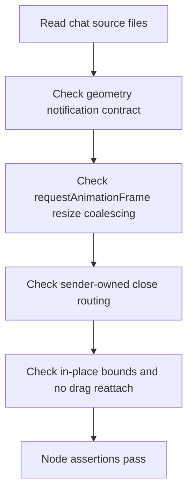

# Chat dock contract test flow

```text
+----------------------------+
| Read renderer/main sources |
+-------------+--------------+
              v
+----------------------------+
| Assert one live geometry   |
| channel and rAF coalescing |
+-------------+--------------+
              v
+----------------------------+
| Assert sender-bound close  |
| cannot target another chat |
+-------------+--------------+
              v
+----------------------------+
| Assert no resize reattach  |
| churn and final publish    |
+----------------------------+
              v
+----------------------------+
| Pass or report contract    |
| regression                 |
+----------------------------+
```


