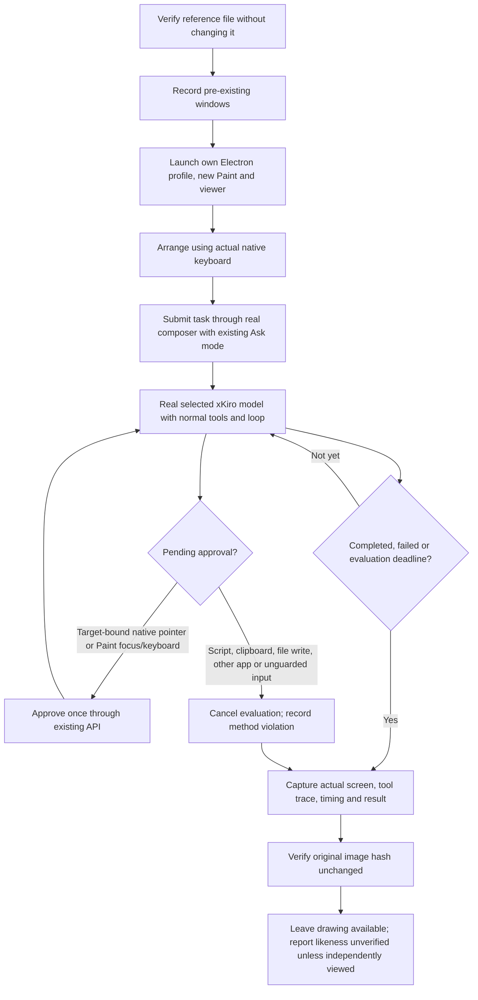

# Paint visual evaluation

This is a live-model evaluation, separate from native input-mechanics tests. No harness-authored artwork, generated vectors, image tracing, clipboard-image substitution or scripted Paint state changes.

```text
+----------------------------+
| Verify reference read-only |
| Record existing window IDs |
+-------------+--------------+
              v
+----------------------------+
| Launch isolated app profile|
| Fresh Paint + image viewer |
| Arrange via native Win keys|
+-------------+--------------+
              v
+----------------------------+
| Submit strict pencil task  |
| Existing Ask approvals only|
+-------------+--------------+
              v
+----------------------------+
| Model observes and chooses |
| every point/tool/key itself|
+-------------+--------------+
              v
+----------------------------+
| Approve only target-bound  |
| native input; stop shortcuts|
+-------------+--------------+
              v
+----------------------------+
| Preserve trace + screenshot|
| Source hash stays unchanged|
| Grade method separately    |
| from visible likeness      |
+----------------------------+
```



The harness launches windows but does not draw, choose the pencil, select colors, author paths or fill in the model's decisions. The regular tool catalog remains available. Existing Ask approval is used to reject prohibited/out-of-target mutations before execution, not to add a production permission system. Native keyboard is approved only while the fresh Paint window is foreground; clipboard paste chords and OS/app-switch shortcuts are rejected. Pointer actions must specify the fresh Paint windowId so production target guards can validate them. This constraint and supervision must be disclosed with results; this is not an unattended quality pass.

The first attempted trial was invalid: generic PID matching accepted a RunDLL error dialog as the viewer. The harness now requires the reference name in the window title and uses a verbatim rundll32 command with its comma outside the quoted DLL path. The corrected live retry has NOT run: the session permission classifier requires separate authorization for automatic approvals. Do not bypass that denial or present this corrected launcher as runtime-verified.

A six-minute whole-task cutoff bounds evaluation cost, not production reasoning. Save model outcome and actual event counts even on failure. Record dispatched strokes, failures and provider calls; do not infer likeness from those counts. Keep the reference image read-only, never clear an existing canvas, do not close or kill unknown user windows. Leave the newly drawn Paint document available at the end. No comparison timing claim without an equivalent CLI native-input trial.
