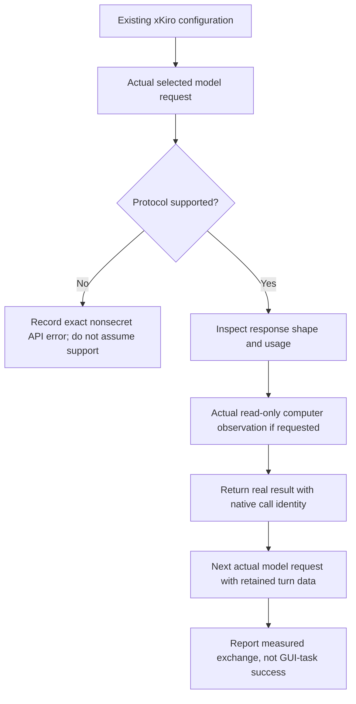

# Real provider continuity probe

Diagnostic only, not a drawing acceptance test. Uses the user's existing xKiro endpoint/credential and exact selected Astra model. No simulated provider, fake tool result, scripted artwork, GUI mutation or automatic approval. Native observations are actual read-only tool results. Secrets never enter logs.

```text
+-----------------------------+
| Existing endpoint + model   |
| No credential values logged |
+--------------+--------------+
               v
+-----------------------------+
| Probe actual API capability |
| Stateless, no mutation tools|
+--------------+--------------+
               v
+-----------------------------+
| Record protocol shape only  |
| IDs, statuses, usage, time  |
+--------------+--------------+
               v
+-----------------------------+
| If supported: real read-only|
| native observation exchange |
| preserve native tool turns  |
+--------------+--------------+
               v
+-----------------------------+
| Diagnose continuity limits  |
| NOT a portrait-quality pass |
+-----------------------------+
```



All output is local. First capability probe uses no tools. Subsequent diagnostic work can expose only read-only desktop inspection, never pointer/keyboard/shell/file writes. A live visual mutation benchmark still requires separately authorized execution and protection of the user's existing documents. No permission-denial workaround is part of this probe.
